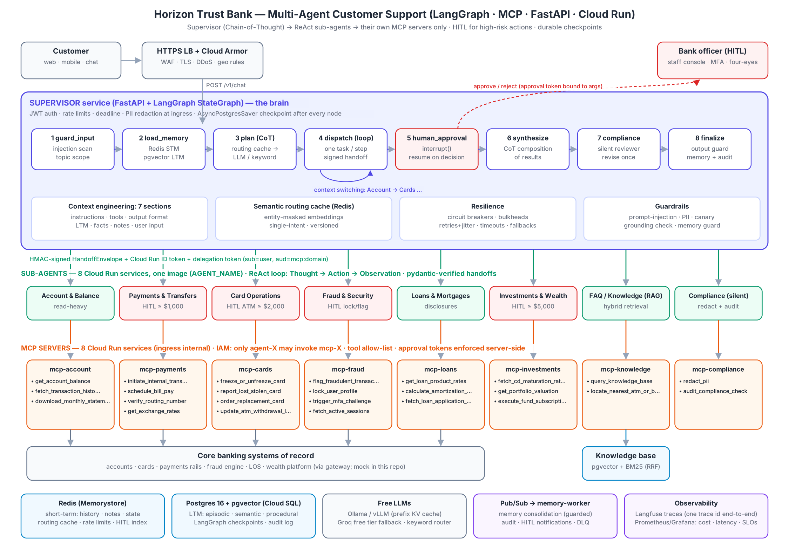
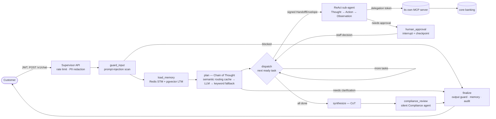

# Horizon Trust Bank — Multi-Agent AI Customer Support

A production-grade reference implementation of an agentic customer-support platform for a bank:
**LangGraph** supervisor + eight **ReAct** sub-agents, each talking only to its own **MCP** server, exposed
through **FastAPI** and deployed as **separate Cloud Run microservices**. Every model it uses is free / open-weight.



> The bank, customers and core-banking data are fictional. `MockCoreBanking` implements realistic rules
> (ownership, limits, idempotency, balances) so the whole system runs end-to-end without real bank systems.

---

## Contents
1. [How a request flows](#1-how-a-request-flows)
2. [Repository layout](#2-repository-layout)
3. [Quick start](#3-quick-start)
4. [Requirement → implementation map](#4-requirement--implementation-map)
5. [The agents and their MCP tools](#5-the-agents-and-their-mcp-tools)
6. [Memory, caching and context engineering](#6-memory-caching-and-context-engineering)
7. [Security & guardrails](#7-security--guardrails)
8. [Scalability & fault tolerance](#8-scalability--fault-tolerance)
9. [Evaluation & testing](#9-evaluation--testing)
10. [Observability & monitoring](#10-observability--monitoring)
11. [Deploying to Cloud Run](#11-deploying-to-cloud-run)
12. [Extending the system](#12-extending-the-system)

---

## 1. How a request flows

> **Full walkthrough:** [docs/FLOW.md](docs/FLOW.md) traces a query from the UI to the reply step by step,
> naming the Python file and function that runs at every step, and covers the cache-hit, multi-intent,
> human-in-the-loop, blocked, degraded, RAG and compliance-rewrite flows.
>
> **Codebase guide:** [docs/CODEBASE.md](docs/CODEBASE.md) explains every Python file in the project —
> what it contains, what it does and how it contributes to the multi-agent system.



**Context switching example** — *"I want to check my balance, and oh by the way, I lost my debit card"*:

1. `plan` (CoT) produces two tasks: `t1 → account`, `t2 → cards` (customer order preserved; fraud would jump the queue).
2. `dispatch` runs **one task per graph step**: the Account agent calls `get_account_balance`; the state is checkpointed.
3. `dispatch` runs again: the Cards agent receives the Account agent's result in `context.prior_results`
   and calls `report_lost_stolen_card`.
4. `synthesize` writes one reply covering both, Compliance reviews it, `finalize` guards and stores it.

This exact trajectory is asserted in `tests/integration/test_trajectories.py::test_context_switching_balance_then_lost_card`.

**Human-in-the-loop for high-risk actions**

```mermaid
sequenceDiagram
    participant U as Customer
    participant S as Supervisor (LangGraph)
    participant P as Payments agent
    participant M as mcp-payments
    participant O as Bank officer
    U->>S: Transfer $1,500 from ACC-100002 to ACC-100001
    S->>P: SubAgentRequest (signed)
    P->>P: policy: amount ≥ threshold → DON'T call tool
    P-->>S: needs_approval + ProposedAction (args SHA-256)
    S->>S: interrupt() — state checkpointed in Postgres
    S-->>U: "pending approval"
    O->>S: GET /v1/hitl/pending · POST /v1/hitl/{thread}/decision (MFA, four-eyes)
    S->>S: resume — mint approval token bound to tool+args, single use
    S->>P: execute_approved + approval token
    P->>M: initiate_internal_transfer(args, approval_token)
    M->>M: verify token ↔ exact args, user, jti unused; idempotency key
    M-->>P: transfer completed
    P-->>S: deterministic confirmation
    S-->>U: final answer (GET /v1/chat/{thread})
```

The MCP server **independently** refuses high-value calls without a valid approval token, so even a
compromised agent cannot move money on its own.

---

## 2. Repository layout

```
bank-agentic-support/
├── libs/bankcore/bankcore/          shared library used by every service
│   ├── config.py                    validated 12-factor settings (pydantic-settings)
│   ├── errors.py                    error hierarchy (safe user messages, retryable flag)
│   ├── schemas/                     pydantic contracts: messages (handoffs), tools (I/O), memory
│   ├── security/                    JWT auth · HMAC envelopes · delegation & approval tokens · service auth
│   ├── guardrails/                  PII redaction · prompt-injection · memory poisoning · output guard
│   ├── resilience/                  circuit breaker · retry · rate limiter · bulkhead · deadlines
│   ├── llm/                         free-LLM factory w/ fallback chain · structured output · KV-cache helpers · embeddings
│   ├── memory/                      Redis short-term · PGVector long-term (episodic/semantic/procedural) · manager
│   ├── cache/semantic_cache.py      Redis semantic cache for supervisor routing decisions
│   ├── context/builder.py           7-section context engineering with token budgets
│   ├── mcp/                         hardened MCP server base + allow-listed MCP client (SDK 2.x / 1.x compat)
│   ├── agents/                      AgentSpecs · shared HITL risk policy · ReAct LangGraph runtime
│   ├── messaging/event_bus.py       Redis Streams / Pub/Sub async events, DLQ
│   ├── observability/               Prometheus metrics · cost tracking · Langfuse tracing
│   ├── core_banking/gateway.py      core-banking gateway (realistic mock)
│   └── testing/                     offline deterministic models + in-process harness
├── services/
│   ├── supervisor/app/              FastAPI API + LangGraph supervisor graph (CoT, HITL, checkpoints)
│   ├── subagent/app/                generic ReAct sub-agent service (AGENT_NAME selects spec)
│   ├── mcp_servers/<domain>/        8 MCP servers (+ knowledge RAG index, compliance rule engine)
│   └── memory_worker/app/           async memory consolidation + audit writer
├── data/kb/                         knowledge-base policy documents (RAG corpus)
├── db/init.sql                      Postgres + pgvector schema
├── eval/                            golden dataset · metrics · runner · HITL review tool
├── tests/unit, tests/integration    109 tests (components, messages, tools, trajectories)
├── docker/ docker-compose*.yml      local stack (+ Langfuse v3, Prometheus, Grafana, Ollama, vLLM)
├── deploy/cloudrun/                 gcloud deploy script, Pub/Sub setup, Knative template
├── monitoring/                      Prometheus scrape config, SLO alerts, Grafana dashboard
└── docs/                            FLOW.md walkthrough · CODEBASE.md file guide · architecture diagram (+ generator script)
```

---

## 3. Quick start

### A. Run the tests and the evaluation (no Docker, no GPU, no API keys)

```bash
python -m venv .venv && source .venv/bin/activate
make install          # pip install -r requirements/dev.txt && pip install -e libs/bankcore
make test             # 109 unit + integration/trajectory tests, fully offline
make eval             # golden dataset with deterministic models + quality gates
```

Offline mode swaps the LLMs for rule-based stand-ins (`bankcore/testing/offline_llm.py`) that speak the same
protocol (JSON plans, tool calls, `Thought:` lines). Everything else — LangGraph, MCP, signing, HITL,
guardrails, compliance, memory — is the real code.

### B. Run the full stack locally

```bash
cp .env.example .env                 # optionally add a free GROQ_API_KEY as LLM fallback
docker compose up -d --build         # 18 app services + Postgres/pgvector + Redis Stack + Ollama + Prometheus/Grafana
docker compose run --rm ollama-pull  # first run: pulls qwen2.5:7b-instruct
docker compose -f docker-compose.observability.yml up -d   # optional: Langfuse v3 on :3000
make ingest                          # optional: load the KB into pgvector
```

Talk to it:

```bash
TOKEN=$(curl -s -X POST localhost:8000/v1/auth/dev-token -H 'content-type: application/json' \
        -d '{"subject":"USR-1001"}' | jq -r .access_token)

curl -s localhost:8000/v1/chat -H "authorization: Bearer $TOKEN" -H 'content-type: application/json' \
  -d '{"message":"I want to check my balance on ACC-100001, and oh by the way, I lost my debit card CRD-100001"}' | jq

# high-value transfer → pending approval
curl -s localhost:8000/v1/chat -H "authorization: Bearer $TOKEN" -H 'content-type: application/json' \
  -d '{"message":"Transfer $1500 from ACC-100002 to ACC-100001"}' | jq '{status, thread_id, pending_approval}'

# bank officer approves
STAFF=$(curl -s -X POST localhost:8000/v1/auth/dev-token -H 'content-type: application/json' \
        -d '{"subject":"STF-001","role":"staff"}' | jq -r .access_token)
curl -s localhost:8000/v1/hitl/pending -H "authorization: Bearer $STAFF" | jq
curl -s -X POST localhost:8000/v1/hitl/<thread_id>/decision -H "authorization: Bearer $STAFF" \
  -H 'content-type: application/json' -d '{"approved": true, "note": "verified by phone"}' | jq
```

Demo data: customer `USR-1001` owns `ACC-100001` (checking), `ACC-100002` (savings), `ACC-100003` (credit),
cards `CRD-100001` (debit ••4821) and `CRD-100002` (credit ••7730), loan `APP-300001`, IRA `INV-400001`,
and a suspicious transaction `TXN-SUSP0001`. `USR-1002` owns `ACC-200001` / `CRD-200001`.

UIs: API docs `http://localhost:8000/docs` · Grafana `:3001` · Prometheus `:9090` · Langfuse `:3000`.

---

## 4. Requirement → implementation map

| # | Requirement | Where |
|---|---|---|
| 1 | Supervisor pattern, sub-agents use tools via MCP | `services/supervisor/app/graph.py`, `services/subagent`, `services/mcp_servers` |
| 2 | Supervisor = Chain of Thought, sub-agents = ReAct | `prompts.py` (`reasoning` steps in `SupervisorPlan`), `bankcore/agents/react.py` |
| 3 | Tools via MCP servers (code included) | `bankcore/mcp/server.py` + 8 servers, 25 tools |
| 4 | Exception handling | `bankcore/errors.py`, uniform `ToolEnvelope`, `http.py` handlers, graceful `failed` responses |
| 5 | Short-term (Redis) & long-term (Postgres+PGVector: episodic/semantic/procedural) memory | `bankcore/memory/*`, `db/init.sql`, `services/memory_worker` |
| 6 | Semantic caching of routing decisions | `bankcore/cache/semantic_cache.py` |
| 7 | Scalability, async communication, fault tolerance | §8 — breakers, bulkheads, retries, deadlines, Pub/Sub/Redis Streams, DLQ, degraded modes |
| 8 | Free LLMs only | Ollama (Qwen2.5/Llama 3.1), vLLM (open weights), Groq free tier; BGE-small embeddings |
| 9 | Context engineering: 7 parts | `bankcore/context/builder.py` |
| 10 | Pydantic validation, verification at handoff | `schemas/`, `security/signing.py` (`seal_envelope` / `open_envelope`) |
| 11 | Security: auth, guardrails, timeouts, circuit breakers, rate limits, HITL | §7, §8 |
| 12 | Prompt injection, memory poisoning, PII redaction | `guardrails/injection.py`, `memory_guard.py`, `pii.py` |
| 13 | Evaluation: golden set, answer/retrieval quality, tool selection, hallucination, unit + trajectory tests, HITL, metrics | `eval/`, `tests/` (§9) |
| 14 | Cost/latency monitoring, Langfuse tracing | `observability/`, `monitoring/` (§10) |
| 15 | Checkpoints while waiting for DB/API/human | LangGraph `AsyncPostgresSaver` (supervisor), checkpointer in every ReAct run, `interrupt()` |
| 16 | KV cache for inference | `llm/kv_cache.py`, stable-prefix prompt layout, vLLM `--enable-prefix-caching`, Ollama `keep_alive` |
| 17 | Microservices, separate Cloud Run service per sub-agent | `deploy/cloudrun/deploy.sh` (18 services) |
| 18 | Diagram + README | this file, `docs/architecture.png` |
| 19 | The 8 sub-agents & their tools | §5 |
| 20 | State isolation · context switching · HITL | §5, §1, `test_trajectories.py` |

---

## 5. The agents and their MCP tools

| Agent (Cloud Run service) | MCP server | Tools | HITL policy |
|---|---|---|---|
| Account & Balance (`agent-account`) | `mcp-account` | `get_account_balance`, `fetch_transaction_history`, `download_monthly_statement` | — (read-only) |
| Payments & Transfers (`agent-payments`) | `mcp-payments` | `initiate_internal_transfer`, `schedule_bill_pay`, `verify_routing_number`, `get_exchange_rates` | transfer / bill pay ≥ $1,000 |
| Card Operations (`agent-cards`) | `mcp-cards` | `freeze_or_unfreeze_card`, `report_lost_stolen_card`, `order_replacement_card`, `update_atm_withdrawal_limit` | ATM limit ≥ $2,000 (blocking a lost card is instant on purpose) |
| Fraud & Security (`agent-fraud`) | `mcp-fraud` | `flag_fraudulent_transaction`, `lock_user_profile`, `trigger_mfa_challenge`, `fetch_active_sessions` | flag + lock always |
| Loans & Mortgages (`agent-loans`) | `mcp-loans` | `get_loan_product_rates`, `calculate_amortization_schedule`, `fetch_loan_application_status` | — |
| Investments & Wealth (`agent-investments`) | `mcp-investments` | `fetch_cd_maturation_rates`, `get_portfolio_valuation`, `execute_fund_subscription` | subscription ≥ $5,000 |
| FAQ / Knowledge — RAG (`agent-knowledge`) | `mcp-knowledge` | `query_knowledge_base` (hybrid dense+BM25, RRF), `locate_nearest_atm_or_branch` | — |
| Compliance — silent (`agent-compliance`) | `mcp-compliance` | `redact_pii`, `audit_compliance_check` (Reg B/ECOA, Reg DD, Reg Z, Reg E, UDAAP, Reg BI, GLBA/GDPR/DPDP) | — |

Thresholds are configurable (`HITL_*` env vars); the single policy in `bankcore/agents/policies.py` is used
both by agents (to propose) and by MCP servers (to enforce).

**State isolation — three independent layers**

1. **Allow-list** – `MCPToolClient` only exposes and only calls the tools in the agent's `AgentSpec`. Calling
   anything else raises `ToolNotPermitted` before any network I/O (the Payments agent literally has no
   `report_lost_stolen_card` in its tool schema).
2. **Network/IAM** – each agent is configured with only its own MCP URL; on Cloud Run, only the `agent-X`
   service account holds `run.invoker` on `mcp-X`, and MCP servers re-check the caller identity.
3. **Token audience** – delegation tokens carry `aud=mcp:<domain>`; any other MCP server rejects them.

The customer identity used by tools comes **only** from the signed delegation token, never from LLM arguments,
so a prompt-injected agent cannot read `USR-1002`'s accounts (`test_cross_customer_data_access_impossible`).

---

## 6. Memory, caching and context engineering

**Short-term memory (Redis)** — `sess:{id}:history` (bounded turns), `:notes` (short-term notes such as
"handled via cards"), `:state`, `:owner` (session bound to one customer → anti-hijacking), all with
inactivity TTL. Falls back to in-process memory if Redis is down.

**Long-term memory (Postgres + PGVector, HNSW cosine indexes)**

| Kind | Table | Written when | Scope |
|---|---|---|---|
| Episodic | `episodic_memory` | each turn (summary, outcome, agents), 180-day TTL | per customer |
| Semantic | `semantic_memory` | stated stable preferences ("I prefer e-mail") | per customer |
| Procedural | `procedural_memory` | successful, compliant, non-rejected, LLM-planned runs → entity-masked "request → agents/tools" recipes, used as planner hints | global |

Writes happen asynchronously in `memory-worker` (event `memory.consolidate`), always through `MemoryGuard`.
Retrieval is hard-filtered by tenant + expiry and re-ranked by *similarity × trust × recency*.
`DELETE /v1/me/memory` implements the right to erasure.

**Semantic routing cache** — the supervisor's routing decision is cached in Redis, keyed by the embedding of
an *entity-masked* query (`send <amount> from <account> to <account>`). Only routes are cached (never data or
answers), only for single-intent, high-confidence plans, never for follow-ups like "yes, do it", and keys are
versioned by prompt version. Uses a RediSearch HNSW index when available, brute-force otherwise.

**Context engineering — every LLM call is built from 7 sections**

```
SystemMessage (stable, trusted → KV-cache prefix)   HumanMessage (dynamic, spotlighted untrusted data)
 1. system instructions + security rules + canary     4. long-term memory   <untrusted_data source="memory">
 2. tools (sorted, canonical JSON)                    5. retrieved facts    <untrusted_data source="retrieval">
 3. output format (JSON schema / answer style)        6. short-term notes + recent turns
                                                      7. user input  (always last)
```

A token budget trims the least valuable content first (old history → low-score facts → low-trust memories).

**KV-cache optimisation** — because sections 1–3 are byte-identical across requests for the same agent
(no timestamps/ids, sorted tools), servers reuse the KV blocks of that prefix:
vLLM `--enable-prefix-caching` (compose `gpu` profile), Ollama `keep_alive=30m` keeps weights and the slot
cache resident. `PrefixTracker` exports `bank_kv_prefix_total{result}` so you can watch reuse in Grafana.
Approved-action confirmations use deterministic templates (no LLM call at all).

---

## 7. Security & guardrails

| Control | Implementation |
|---|---|
| Customer & staff authentication | OAuth2 bearer JWT (`security/auth.py`); IdP-issued RS256 in prod, HS256 dev tokens. Staff must hold `hitl:approve` **and** have MFA (`amr` contains `otp`). |
| Service-to-service auth | Cloud Run IAM ID tokens (`SERVICE_AUTH_MODE=gcp`) + caller allow-lists; HS256 service JWTs locally. |
| Handoff integrity | `HandoffEnvelope`: HMAC-SHA256 over canonical JSON, recipient/sender check, 120 s anti-replay window, payload hash, then strict pydantic re-validation (`extra="forbid"`). |
| Delegation | 5-minute token "agent X acts for user U on mcp:X". |
| HITL approvals | Approval tokens bound to tool + SHA-256 of canonical args + customer, single-use (jti), 15-min expiry, four-eyes (reviewer ≠ customer), approval window/SLA. |
| Prompt injection (direct) | `InputGuard`: NFKC + zero-width stripping, weighted signatures (override, role hijack, exfiltration, tool spoofing, approval bypass, mass exfil, base64 payloads), optional free DeBERTa classifier. Blocked before any agent runs. |
| Prompt injection (indirect) | Tool outputs, RAG chunks and memories are scanned, defanged and wrapped in `<untrusted_data>`; poisoned KB chunks are quarantined at ingestion. |
| Memory poisoning | `MemoryGuard`: injection scan, instruction-about-security detector, provenance + trust, procedural memory only from system/staff and global, tenant namespace, PII minimisation, dedup hash, quarantine table. |
| PII | Redacted at ingress (before LLMs, caches, logs, checkpoints), in logs (structlog processor), in outputs, and by the Compliance agent. Cards (Luhn), SSN, Aadhaar, PAN, e-mail, phone, IBAN, CVV/PIN/password, account numbers; public routing numbers are preserved. Optional Presidio NER. |
| Output guard | Canary-token leak detection, reasoning stripping, PII redaction, **grounding check** (money/percent figures must appear in tool evidence). |
| Compliance review | Deterministic rule engine + required disclosures; one LLM revision, then safe fallback. |
| Rate limits | Redis sliding window per user/minute, per user/day, per IP; per-tool limits (e.g. 5 transfers/hour). |
| Timeouts / deadlines | Request deadline propagated in every handoff; per-LLM, per-sub-agent, per-MCP timeouts. |
| Banking safety | Ownership checks in the gateway (not-found for others' resources), idempotency keys, daily limits, no transfers from credit lines. |
| Hardening | Non-root read-only containers, security headers, body-size limit, CORS allow-list, no stack traces in responses, secrets from Secret Manager, refuse to boot in prod with dev secrets. |

---

## 8. Scalability & fault tolerance

* **Stateless services** — all state lives in Redis/Postgres, so every Cloud Run service scales horizontally
  (per-service concurrency, min/max instances, CPU boost; Fraud gets extra headroom).
* **Durable workflows** — LangGraph checkpoints after every node; a run paused for approval survives restarts
  and scale-to-zero. Each ReAct run is checkpointed too.
* **Circuit breakers** per LLM provider, sub-agent and MCP server (business errors never trip them).
* **Bulkheads** bound concurrency per dependency; **retries** with exponential back-off + jitter only for
  retryable/idempotent work; money-moving calls rely on idempotency keys.
* **Graceful degradation** — LLM chain Ollama/vLLM → Groq → keyword router; Redis down → local memory and rate
  limiting; Postgres down → in-memory checkpointer (alerted); Compliance down → deterministic scrub; one failed
  sub-agent → partial answer for the rest (`test_subagent_failure_partial_success`).
* **Asynchronous communication** — memory consolidation, audit, HITL notifications go through Redis Streams
  (consumer groups, XAUTOCLAIM, DLQ) or Pub/Sub push subscriptions with retry policy and dead-letter topics.
  Consumers are idempotent.
* Optional parallel dispatch of independent tasks (`SupervisorDeps.parallel_independent`).

---

## 9. Evaluation & testing

```bash
make test                                   # unit + integration
python eval/run_eval.py --offline           # deterministic, CI gate
python eval/run_eval.py --online --judge    # real free LLMs + LLM-as-judge
python eval/run_eval.py --api http://localhost:8000   # black-box against a deployed stack
python eval/hitl_review.py review --reviewer STF-001  # human review of sampled answers
python eval/hitl_review.py score            # agreement between humans and automatic metrics
```

**Golden dataset** (`eval/golden_dataset.jsonl`, 33 cases): single intents for every agent, multi-intent
context switching, HITL approve/reject, RAG questions with relevant documents, prompt-injection attacks and
a cross-customer access attempt. Each case has expected agents, expected tool trajectory, required facts,
forbidden content, expected status and HITL decision.

| Area | Metrics |
|---|---|
| Routing | ordered-agent accuracy |
| Tool selection | precision / recall / F1 over `agent:tool` |
| Trajectory | exact, in-order (subsequence), any-order, LCS ratio |
| Answer quality | fact recall, forbidden-content rate, LLM-judge correctness/helpfulness |
| Hallucination | ungrounded-figure rate vs. tool/KB evidence, LLM-judge faithfulness |
| Retrieval | recall@4, precision@4, MRR, nDCG@4 |
| Guardrails | block recall on attacks, false-positive rate on benign traffic |
| HITL | trigger accuracy; human↔auto agreement (Cohen's κ) |
| Ops | p50/p95 latency, tokens, (shadow) cost |

Quality gates (`GATES` in `run_eval.py`) fail the CI build. Example offline result:
routing 1.00 · tool F1 1.00 · fact recall 1.00 · hallucination 0.00 · guardrail recall 1.00 / FP 0.00 ·
HITL accuracy 1.00 — reports land in `eval/reports/report.{json,md}` and scores go to Langfuse.
(The evaluation already caught two real bugs during development: routing numbers being redacted as account
numbers, and `$1500.00` being parsed as `$150` by the grounding check — both now have regression tests.)

**Tests** — `tests/unit` covers schemas & handoff validation, signing/tokens, PII/injection/memory/output
guardrails, circuit breaker/retry/rate limit/bulkhead, Redis memory, vector memory isolation, semantic cache,
context builder, every MCP domain (ownership, HITL enforcement, idempotency, business rules), the ReAct loop
(disallowed tools, self-correction, indirect injection, iteration cap, LLM outage) and the eval metrics.
`tests/integration` runs the whole system in-process and asserts **trajectories**: context switching, handoff
context, HITL approve/reject/replay, fraud-first ordering, injection blocking, RAG grounding, LLM outage
fallback, partial failure, routing-cache hits, authN/authZ, session hijack, four-eyes and compliance rewrite.

---

## 10. Observability & monitoring

* **Langfuse (self-hosted, open source)** — the supervisor creates one trace id that travels inside every
  handoff envelope; supervisor CoT generations, sub-agent ReAct generations and scores (injection score,
  compliance pass, HITL decision, ungrounded figures, eval metrics) all attach to that trace.
* **Prometheus metrics** on every service (`/metrics`): request/LLM/tool latency histograms, tokens and
  (shadow) cost per model, tool outcomes, agent task status, routing-cache hit rate, KV-prefix reuse,
  guardrail interventions, HITL events, circuit states, memory operations.
* **Grafana dashboard** (`monitoring/grafana/dashboards/bank-agentic.json`) and **SLO alerts**
  (`monitoring/alerts.yml`): p95 latency, open circuits, injection spikes, HITL backlog, ungrounded figures,
  daily cost budget, low cache hit rate.
* **Structured JSON logs** with request/trace ids, PII-scrubbed — ready for Cloud Logging.
* **Cost** — free models cost $0 in cash; set `PRICE_PER_MTOK_*` shadow prices (e.g. GPU amortisation or the
  paid-API equivalent) to compare options.

---

## 11. Deploying to Cloud Run

One image, 18 services: `supervisor`, `agent-{8}`, `mcp-{8}`, `memory-worker`.

1. **Infrastructure**: Artifact Registry repo, Cloud SQL Postgres 16 (enable `vector`, run `db/init.sql`),
   Memorystore Redis 7, Serverless VPC connector, HTTPS Load Balancer + Cloud Armor in front of the supervisor,
   and an LLM endpoint: vLLM on GKE/Compute GPU (prefix caching) and/or a Groq key for the free tier.
2. **Secrets** in Secret Manager: `jwt-secret`, `handoff-secret`, `delegation-secret`, `approval-secret`,
   `postgres-dsn`, `groq-api-key`, `langfuse-public-key`, `langfuse-secret-key`.
3. **Deploy**:
   ```bash
   PROJECT=my-bank-prj REGION=asia-south1 REDIS_URL=redis://10.0.0.3:6379/0 \
   CLOUDSQL_INSTANCE=my-bank-prj:asia-south1:bank-pg VLLM_BASE_URL=http://10.0.0.10:8000/v1 \
   ./deploy/cloudrun/deploy.sh
   ```
   The script builds the image, creates one service account per service, deploys MCP servers and agents with
   `--ingress internal --no-allow-unauthenticated`, grants `run.invoker` only along allowed edges
   (`agent-X → mcp-X`, `supervisor → agent-*`), deploys the supervisor behind the LB, and creates Pub/Sub topics,
   push subscriptions and dead-letter topics (`pubsub.sh`).
4. **CI/CD**: `cloudbuild.yaml` (or `.github/workflows/ci.yml`) runs tests → offline eval gate → build → deploy.
   `deploy/cloudrun/service.template.yaml` is a declarative alternative for GitOps.

---

## 12. Extending the system

* **Add a tool** — define input/output models in `schemas/tools.py`, register it with `@srv.tool(...)` in the
  domain's MCP server, add it to the agent's `AgentSpec.tools`, and (if risky) to `agents/policies.py`.
* **Add an agent** — new `AgentName`, `AgentSpec`, MCP server module, compose/Cloud Run entries; the supervisor
  picks it up from `routing_catalog()` automatically.
* **Real core banking** — implement the `MockCoreBanking` method set against your system of record.
* **Better models** — any free model works through Ollama/vLLM/Groq; set `SUPERVISOR_MODEL` / `SUBAGENT_MODEL`.
  Use `EMBEDDING_BACKEND=sentence-transformers` (build with `WITH_ML=true`) for BGE-small embeddings.
* **MCP SDK** — targets `mcp` 2.x; `bankcore/mcp/compat.py` keeps 1.x working.

### Production checklist
Replace dev secrets · connect a real IdP · move the approval-jti store and circuit-breaker state to Redis for
multi-instance consistency · tune HITL thresholds with risk/compliance · run `--online --judge` evaluation on
every model or prompt change · red-team guardrails regularly · configure data retention per regulation (RBI,
DPDP, GDPR, GLBA).
