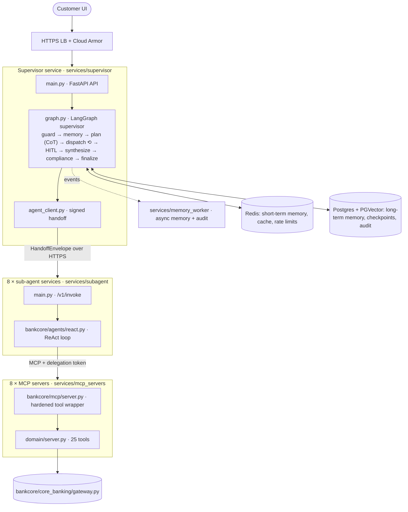
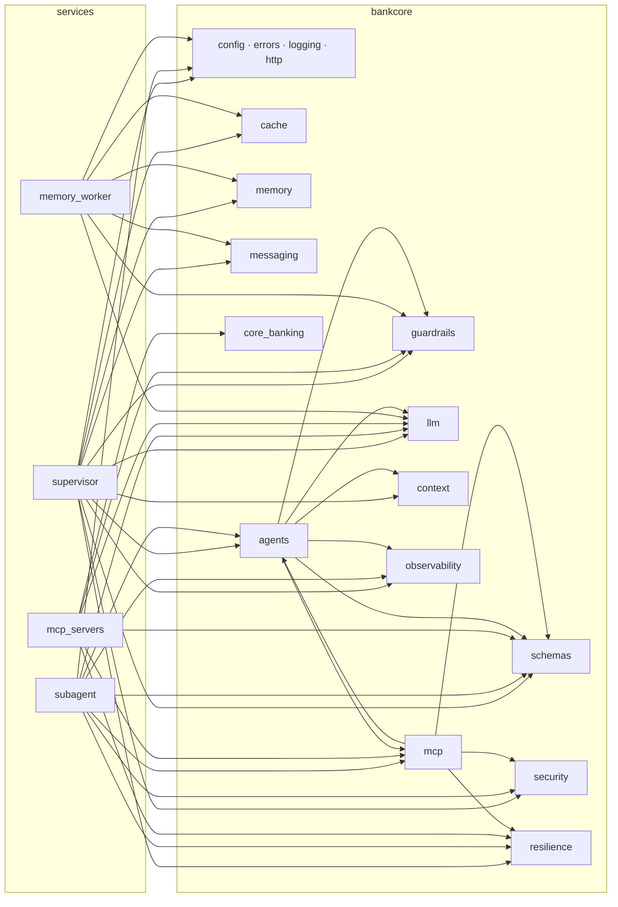

# Codebase guide — every Python file, and how they work together

This guide explains the whole application: the end-to-end flow from the customer's UI to the reply, and then
**every one of the 109 Python files** in the repository — what it contains, what it does, and how it
contributes to the multi-agent system.

- For a deeper, step-by-step trace of a single request (with sequence diagrams for HITL and caching), see
  [FLOW.md](FLOW.md).
- Paths are relative to the repository root. `bankcore/…` is shorthand for `libs/bankcore/bankcore/…`.

---

## Contents

1. [The architecture in one page](#1-the-architecture-in-one-page)
2. [End-to-end flow, from UI to reply](#2-end-to-end-flow-from-ui-to-reply)
3. [Shared library `bankcore`](#3-shared-library-bankcore)
   - [3.1 Package root, configuration, errors, logging, HTTP](#31-package-root-configuration-errors-logging-http)
   - [3.2 `schemas/` — data contracts](#32-schemas--data-contracts)
   - [3.3 `security/` — identity, signing, tokens](#33-security--identity-signing-tokens)
   - [3.4 `guardrails/` — safety filters](#34-guardrails--safety-filters)
   - [3.5 `resilience/` — fault tolerance](#35-resilience--fault-tolerance)
   - [3.6 `llm/` — models, embeddings, structured output, KV cache](#36-llm--models-embeddings-structured-output-kv-cache)
   - [3.7 `context/` — context engineering](#37-context--context-engineering)
   - [3.8 `cache/` — semantic routing cache](#38-cache--semantic-routing-cache)
   - [3.9 `memory/` — short- and long-term memory](#39-memory--short--and-long-term-memory)
   - [3.10 `messaging/` — asynchronous events](#310-messaging--asynchronous-events)
   - [3.11 `observability/` — metrics, cost, tracing](#311-observability--metrics-cost-tracing)
   - [3.12 `mcp/` — MCP server and client](#312-mcp--mcp-server-and-client)
   - [3.13 `agents/` — specs, risk policy, ReAct runtime](#313-agents--specs-risk-policy-react-runtime)
   - [3.14 `core_banking/` — system-of-record gateway](#314-core_banking--system-of-record-gateway)
   - [3.15 `testing/` — offline models and test harness](#315-testing--offline-models-and-test-harness)
4. [Services](#4-services)
   - [4.1 Supervisor](#41-supervisor-servicessupervisorapp)
   - [4.2 Sub-agent](#42-sub-agent-servicessubagentapp)
   - [4.3 MCP servers](#43-mcp-servers-servicesmcp_servers)
   - [4.4 Memory worker](#44-memory-worker-servicesmemory_workerapp)
5. [Evaluation](#5-evaluation-eval)
6. [Tests](#6-tests-tests)
7. [Scripts and docs tooling](#7-scripts-and-docs-tooling)
8. [Package marker files](#8-package-marker-files-__init__py)
9. [Non-Python files that the Python code depends on](#9-non-python-files-that-the-python-code-depends-on)
10. [Who imports what](#10-who-imports-what)

---

## 1. The architecture in one page

Three design ideas explain most of the code:

1. **One shared library (`libs/bankcore`)** holds every cross-cutting concern — contracts, security,
   guardrails, resilience, memory, LLM access, MCP plumbing, observability — so all 18 services behave the
   same way.
2. **One bespoke orchestrator, one generic worker.** The supervisor (`services/supervisor/app/graph.py`) is
   custom LangGraph code. The eight sub-agents are a single generic ReAct runtime (`bankcore/agents/react.py`)
   configured by declarative `AgentSpec`s; one image is deployed eight times.
3. **Identity and integrity travel as signed tokens.** Customer identity is fixed at the API, then carried as
   a delegation token to MCP servers; every handoff is an HMAC-signed envelope; high-risk actions need a
   separate approval token.

---

## 2. End-to-end flow, from UI to reply

Each step names the file(s) that run it. (Detail per step: [FLOW.md §3–6](FLOW.md#3-the-main-path-step-by-step).)

| # | Step | What happens | Python file(s) |
|---|---|---|---|
| 0 | Start-up | Container picks its service from `SERVICE`; settings validated; logging configured; dependencies wired; graphs compiled | `docker/entrypoint.sh` → `bankcore/config.py`, `bankcore/logging.py`, `services/supervisor/app/container.py`, `services/supervisor/app/graph.py` |
| 1 | UI | Customer logs in at the bank's IdP, gets a JWT, sends `POST /v1/chat` (UI not in repo; dev tokens via `/v1/auth/dev-token`) | `services/supervisor/app/main.py · dev_token` → `bankcore/security/auth.py · issue_token` |
| 2 | Edge | TLS, WAF, DDoS (infrastructure, not Python) | `deploy/cloudrun/deploy.sh` sets ingress |
| 3 | HTTP hardening | Request id, body-size limit, latency metric, security headers, error handlers | `bankcore/http.py · harden` |
| 4 | Body validation | `ChatRequest` schema (length, session-id pattern, channel, no extra fields) | `bankcore/schemas/messages.py · ChatRequest` |
| 5 | Authentication | JWT signature, issuer, audience, expiry, `customer` role | `bankcore/security/auth.py · get_principal, decode_token, require_customer` |
| 6 | Rate limiting | Per user/minute, per user/day, per IP (Redis Lua sliding window) | `bankcore/resilience/rate_limiter.py · RateLimiter.hit` |
| 7 | Session binding | Session id bound to this customer; thread id + trace id created | `bankcore/memory/short_term.py · bind_owner`; `bankcore/observability/tracing.py · new_trace_id` |
| 8 | PII redaction | Message scrubbed before any LLM, cache, log, checkpoint or memory | `bankcore/guardrails/pii.py · redact_text` |
| 9 | Graph start | Usage + Langfuse callbacks; `graph.ainvoke` under the request deadline | `services/supervisor/app/main.py · chat`; `bankcore/observability/cost.py`, `tracing.py` |
| 10 | `guard_input` | Direct prompt-injection scan, PII, scope → blocked messages skip to `finalize` | `graph.py · guard_input` → `bankcore/guardrails/__init__.py · InputGuard`, `bankcore/guardrails/injection.py` |
| 11 | `load_memory` | Redis history/notes/state + PGVector episodic/semantic/procedural memories | `graph.py · load_memory` → `bankcore/memory/manager.py`, `short_term.py`, `long_term.py`, `bankcore/llm/embeddings.py` |
| 12 | `plan` (CoT) | Semantic routing cache → else 7-section context + LLM → validated `SupervisorPlan` → else keyword router; fraud first | `graph.py · plan` → `bankcore/cache/semantic_cache.py`, `bankcore/context/builder.py`, `services/supervisor/app/prompts.py`, `bankcore/llm/structured.py`, `bankcore/llm/factory.py`, `services/supervisor/app/fallback_router.py` |
| 13 | `dispatch` | Next ready task → `SubAgentRequest` + delegation token → signed envelope → HTTPS with breaker, bulkhead, retry, timeout → verify reply | `graph.py · dispatch, _request` → `services/supervisor/app/agent_client.py`, `bankcore/security/signing.py`, `bankcore/security/service_auth.py`, `bankcore/resilience/*` |
| 14 | Sub-agent entry | Service auth before body parse; envelope verified; deadline + bulkhead | `services/subagent/app/main.py · _service_auth, invoke` |
| 15 | ReAct loop | Context built; `reason` (LLM) ⇄ `act` (allow-list, arg validation, HITL policy, MCP call, output verification, injection scan); iteration cap | `bankcore/agents/react.py`, `bankcore/agents/specs.py`, `bankcore/agents/policies.py`, `bankcore/mcp/client.py`, `bankcore/schemas/tools.py` |
| 16 | MCP server | Caller check, delegation token, rate limit, input validation, approval token, idempotency, domain tool, output validation | `bankcore/mcp/server.py · BankMCPServer._execute` → `services/mcp_servers/<domain>/server.py` |
| 17 | Core banking | Ownership and business rules, idempotent money movement | `bankcore/core_banking/gateway.py · MockCoreBanking` |
| 18 | Agent reply | Answer guarded (PII, canary, grounding) and sealed back | `bankcore/agents/react.py · _to_response`; `bankcore/guardrails/output_guard.py`; `bankcore/security/signing.py · seal_envelope` |
| 19 | Loop / HITL | More tasks → `dispatch` again; approval needed → `human_approval` interrupts with a checkpoint; staff decision resumes it | `graph.py · after_dispatch, human_approval`; `services/supervisor/app/hitl.py`; `main.py · hitl_pending, hitl_decide` |
| 20 | `synthesize` | One result → direct; several → CoT composition by the LLM | `graph.py · synthesize`; `prompts.py` |
| 21 | `compliance_review` | Silent Compliance agent: `redact_pii` + `audit_compliance_check`; revise once; safe fallback | `graph.py · compliance_review` → `services/mcp_servers/compliance/server.py`, `rules.py` |
| 22 | `finalize` | Output guard with evidence; Redis history + notes; publish memory and audit events | `graph.py · finalize`; `bankcore/guardrails/output_guard.py`; `bankcore/memory/manager.py`; `bankcore/messaging/event_bus.py` |
| 23 | Response | `ChatResponse` built from the checkpointed state | `main.py · _build_response`; `bankcore/schemas/messages.py · ChatResponse` |
| 24 | Async memory + audit | Worker consumes events, writes guarded memories and audit rows | `services/memory_worker/app/main.py`; `bankcore/guardrails/memory_guard.py`; `bankcore/memory/long_term.py` |
| ∞ | Cross-cutting | Logs, metrics, traces, cost at every step | `bankcore/logging.py`, `bankcore/observability/*` |

---

## 3. Shared library `bankcore`

Installed as a package (`libs/bankcore/pyproject.toml`) into every container image. Nothing in it depends on
any service; services depend on it.

### 3.1 Package root, configuration, errors, logging, HTTP

#### `bankcore/__init__.py`
Package docstring and `__version__`. Explains why the library exists: changing a contract or a security control
in one place changes it for all services.

#### `bankcore/config.py`
**Centralised, validated configuration** (pydantic-settings, 12-factor: everything from environment variables).
- `Environment` (local/test/staging/production) and `LLMProvider` (groq, ollama, vllm, fake) enums.
- `Settings` groups every knob: LLM provider chain and model names; Ollama `keep_alive`/`num_ctx`; vLLM URL;
  embedding backend; Redis and Postgres DSNs; short-term TTLs; semantic-cache threshold and TTL; JWT,
  handoff-HMAC, delegation and approval secrets; service-auth mode (`local`/`gcp`); rate limits; deadlines and
  timeouts; circuit-breaker and bulkhead settings; ReAct iteration cap; HITL thresholds; agent and MCP URLs;
  event-bus backend; Langfuse keys; shadow prices for cost; `agent_name` for sub-agent containers.
- A validator rejects secrets shorter than 32 bytes; `get_settings()` (cached) refuses to start in staging or
  production with development secrets.

**Contribution:** every service reads the same typed configuration, so behaviour is controlled by deployment
config (Cloud Run env vars and Secret Manager), not code changes.

#### `bankcore/errors.py`
**The error hierarchy.** Base `BankAgentError` carries a stable `code`, an `http_status`, a `retryable` flag
and a customer-safe `user_message`. Subclasses:
- client/validation: `ValidationFailed`, `AuthenticationError`, `AuthorizationError`, `RateLimitExceeded`,
  `GuardrailViolation`, `HandoffVerificationError`, `ToolNotPermitted`, `ApprovalRequired`;
- domain (not retryable): `BankingDomainError`, `NotFound`;
- infrastructure (retryable): `DependencyError`, `DependencyTimeout`, `CircuitOpenError`, `LLMError`,
  `LLMOutputParseError`.

**Contribution:** one vocabulary for failures. Retries and circuit breakers read `retryable`; HTTP handlers
turn errors into safe JSON; sub-agents turn them into typed `failed` responses — no stack traces ever cross a
service boundary.

#### `bankcore/logging.py`
**Structured JSON logging with mandatory PII scrubbing** (structlog).
- `request_id_var`, `trace_id_var` context variables, added to every log line by `_context_processor`.
- `_redact_processor` masks sensitive keys (`password`, `token`, `authorization`, `delegation_token`, …) and runs
  `redact_text` over every string value.
- `configure_logging(service, level)` and `get_logger(name)`.

**Contribution:** logs from 18 services can be correlated by request and trace id in Cloud Logging, and card
numbers or secrets can never be written to logs.

#### `bankcore/http.py`
**Shared FastAPI hardening.** `harden(app, service)` adds:
- middleware: request id, 256 KB body limit (413), `bank_request_latency_seconds` histogram, security headers
  (HSTS, nosniff, DENY frames, no-referrer, no-store);
- exception handlers: `BankAgentError` → safe JSON; request validation → 422 with field names only;
  unhandled → generic 500;
- a `/metrics` endpoint for Prometheus.

**Contribution:** the supervisor, every sub-agent and the memory worker get identical HTTP behaviour.

### 3.2 `schemas/` — data contracts

All models extend `StrictModel` (`extra="forbid"`, strings stripped, assignment validated), so unknown or
malformed fields are rejected at every boundary.

#### `bankcore/schemas/common.py`
- `StrictModel`; enums `AgentName` (the eight agents), `RiskLevel`, `Role` (customer, staff, service).
- **Constrained identifier types**: `UserId` (`USR-####`), `AccountId` (`ACC-######`), `CardId`, `TransactionId`,
  `PayeeId`, `LoanApplicationId`, `InvestmentAccountId`, `FundId`, `CurrencyCode`, `RoutingNumber` (9 digits),
  `SafeText`.
- `Money`: positive, ≤ 1,000,000, two decimal places, **quantised to 2 dp** so `250`, `250.0` and `"250.00"`
  hash identically (approval tokens depend on this).
- `TokenUsage` (addable) and `ErrorInfo`.

**Contribution:** the LLM can't invent a malformed account id or amount — validation rejects it before it reaches
a tool.

#### `bankcore/schemas/messages.py`
**Every message that crosses an agent boundary.**
- Public API: `ChatRequest`, `ChatResponse`, `TaskSummary`, `PendingApprovalView`, `ApprovalDecision`.
- Supervisor plan: `PlannedTask` (compliance agent cannot be planned) and `SupervisorPlan` — the CoT
  `reasoning` steps, `intents`, `tasks`, clarification fields and `confidence`, with a validator that rejects
  duplicate task ids, unknown/self dependencies, **dependency cycles** (Kahn's algorithm), more than 6 tasks,
  and empty plans without a clarification question.
- Handoff: `PriorResult`, `HandoffContext`, `SubAgentRequest` (modes `plan_and_execute` /
  `execute_approved`), `ToolCallRecord`, `SubAgentResponse` (status consistency rules), `ProposedAction` (hashes
  its arguments with SHA-256 and rejects tampering), `HandoffEnvelope`.
- Compliance and audit: `ComplianceViolation`, `ComplianceVerdict`, `AuditEvent`.
- `canonical_json()` — deterministic JSON used for all hashing and signing.

**Contribution:** the backbone of "message verification at handoff" — every handoff is validated when sent and
again when received.

#### `bankcore/schemas/tools.py`
**Input and output contracts for all 25 MCP tools**, grouped by domain (accounts, payments, cards, fraud,
loans, investments, knowledge, compliance). Examples: `InternalTransferInput` (source ≠ destination),
`DateRange` (ordered, ≤ 1 year), `BillPayInput` (date not in the past), `AmortizationInput` (rate 0–40 %,
term ≤ 480 months).
- `ToolEnvelope` / `ToolError` — the uniform result every tool returns (tools never raise across MCP).
- `TOOL_INPUT_MODELS` — used by sub-agents to canonicalise LLM-produced arguments before calling a tool.
- `TOOL_OUTPUT_MODELS` — used by the MCP client to verify outputs on the way back.

**Contribution:** tools are type-checked on both sides of the MCP boundary, so a buggy or compromised server
can't feed malformed data into an agent.

#### `bankcore/schemas/memory.py`
- `MemoryKind` (episodic, semantic, procedural), `MemorySource` (user statement, tool-verified, agent summary,
  staff) and `TRUST_BY_SOURCE` (provenance-based trust ceilings).
- `MemoryRecord` (what gets stored), `RetrievedMemory` (what comes back from search), `ConversationTurn`
  (a short-term history entry).

**Contribution:** typed memory with provenance and trust, which the memory guard and re-ranker rely on.

### 3.3 `security/` — identity, signing, tokens

#### `bankcore/security/auth.py`
**Customer and staff authentication.**
- `Principal` — frozen identity: subject, role, scopes, token id, `mfa_verified` (from the `amr` claim).
- `issue_token()` — development/test token issuer (production tokens come from the IdP).
- `decode_token()` — verifies signature, issuer, audience, `exp`/`iat`/`nbf`, required claims; distinguishes
  expired tokens.
- FastAPI dependencies: `get_principal`, `require_customer` (role customer), `require_staff` (role staff +
  `hitl:approve` scope + MFA).

**Contribution:** the single entry point for user identity; everything downstream trusts only the `Principal`.

#### `bankcore/security/service_auth.py`
**Service-to-service authentication.**
- `outbound_service_token(audience, caller, url=…)` — in `gcp` mode fetches a Google-signed ID token whose
  audience is the callee's Cloud Run URL; locally signs a short HS256 service JWT. Tokens are cached until a
  minute before expiry.
- `verify_service_request(request, audience, allowed_callers)` — verifies the incoming service token and checks
  the caller against an allow-list.

**Contribution:** only the supervisor can call sub-agents, and only `agent-X` can call `mcp-X` — network-level
state isolation.

#### `bankcore/security/signing.py`
**Cryptographic integrity for handoffs, delegation and approvals.**
- `seal_envelope()` / `open_envelope()` — HMAC-SHA256 envelopes over message id, sender, recipient, timestamp,
  payload type and payload hash; verification checks recipient, sender, 120 s freshness, type, hash and
  signature (constant-time), then re-validates the payload model.
- `issue_delegation_token()` / `verify_delegation_token()` — 5-minute JWT "agent X acts for customer U",
  audience `mcp:<domain>`.
- `issue_approval_token()` / `verify_approval_token()` — post-approval JWT bound to the exact tool, argument
  hash and customer, with a unique `jti` for single use.

**Contribution:** the trust chain between services. MCP servers derive the customer only from delegation tokens,
and refuse high-risk calls without a matching approval token.

### 3.4 `guardrails/` — safety filters

#### `bankcore/guardrails/__init__.py`
Facade: re-exports the detectors and defines **`InputGuard`** / `InputGuardResult` — runs the injection
detector, redacts PII and applies a simple off-topic check. Used by the supervisor's `guard_input` node.

#### `bankcore/guardrails/pii.py`
**PII detection and redaction.**
- `luhn_valid()`; card numbers masked as `[CARD ****1234]` only when Luhn-valid.
- Regex patterns for SSN, Aadhaar, Indian PAN, e-mail, IBAN, phone, CVV, PIN, password/OTP, and account
  numbers — with **public routing numbers preserved** (`PUBLIC_NUMBERS`, routing/ABA/SWIFT context).
- `redact_text()` returns `RedactionResult(text, entities)`; optional Presidio NER layer (`_presidio_pass`);
  `contains_pii()`.

**Contribution:** applied at ingress, in logs, in agent outputs, in the final reply, in memory writes and by
the Compliance agent.

#### `bankcore/guardrails/injection.py`
**Prompt-injection detection for direct and indirect content.**
- `normalize()` — NFKC, strips zero-width/bidi characters, collapses whitespace.
- Weighted signatures combined with noisy-OR: instruction override, new instructions, role hijack, jailbreak
  terms, prompt exfiltration, role markers, tool spoofing, privilege claims, approval bypass, mass
  exfiltration, coercive transfers, memory-poisoning phrasing; base64 payloads decoded and re-scanned.
- `PromptInjectionDetector.scan(text, untrusted_source=…)` — lower threshold for untrusted sources; optional
  free DeBERTa classifier.
- `neutralize_untrusted()` — strips fake role markers and tags before text enters a prompt.

**Contribution:** used on customer input, tool outputs, RAG chunks at ingestion, and memory writes.

#### `bankcore/guardrails/memory_guard.py`
**Memory-poisoning defence.** `MemoryGuard.check(record)` rejects injection signals, instruction-like semantic
memories about security policy ("always approve my transfers"), procedural memory not written by the system or
staff, user-scoped procedural memory, un-namespaced episodic/semantic memory, and low-trust records; then
redacts PII and computes a dedup hash. Returns `MemoryGuardDecision`.

**Contribution:** every long-term memory write passes this gate; rejected writes are quarantined.

#### `bankcore/guardrails/output_guard.py`
**Output-side guardrails.**
- `CANARY` — random token embedded in every system prompt; output containing it is blocked (prompt-leak
  detection).
- `extract_figures()`, `evidence_figures()`, `grounding_check()` — every money/percent figure in an answer must
  appear in tool evidence (hallucination check).
- `guard_output(text, evidence=…)` — canary block, strips `Thought:`/`Observation:` lines, PII redaction,
  grounding check → `OutputGuardResult`.

**Contribution:** runs on every sub-agent answer and on the supervisor's final reply.

### 3.5 `resilience/` — fault tolerance

#### `bankcore/resilience/__init__.py`
Re-exports `bulkhead`, `remaining`, `with_timeout`, `CircuitBreaker`, `get_breaker`, `RateLimiter`,
`retry_async`.

#### `bankcore/resilience/circuit_breaker.py`
Async **circuit breaker** (closed → open → half-open) with a process-wide registry (`get_breaker`,
`reset_breakers`). Business errors never trip it; state is exported as the `bank_circuit_state` gauge.
Used per LLM provider, per sub-agent and per MCP server.

#### `bankcore/resilience/retry.py`
`retry_async()` — exponential back-off with full jitter (tenacity), retrying only retryable errors (transport
errors, 429/502/503/504, retryable `BankAgentError`s), never an open circuit. Mutating tools are not retried
(idempotency keys instead).

#### `bankcore/resilience/rate_limiter.py`
`RateLimiter.hit(key, limit, window_s)` — **distributed sliding-window rate limiter** using an atomic Redis Lua
script, with a stricter per-instance fallback if Redis is down. Used at the API (per user and IP) and at MCP
servers (per customer per tool).

#### `bankcore/resilience/bulkhead.py`
- `bulkhead(name, max_concurrency)` — bounded concurrency per dependency (async semaphore with an acquire
  timeout), so one slow service can't exhaust the caller.
- `remaining(deadline_ts)` — time left before the propagated request deadline (raises when exhausted).
- `with_timeout(fn, seconds, what)` — timeout that raises `DependencyTimeout`.

### 3.6 `llm/` — models, embeddings, structured output, KV cache

#### `bankcore/llm/__init__.py`
Re-exports `ResilientLLM`, `set_fake_model_factory`, `extract_json`, `invoke_structured`.

#### `bankcore/llm/factory.py`
**Free-LLM factory with a provider fallback chain.**
- `build_chat_model(provider, role)` — Ollama (`ChatOllama`, `keep_alive` keeps weights and KV cache resident),
  Groq free tier (`ChatGroq`), self-hosted vLLM via the OpenAI-compatible client (prefix caching), or the
  fake/test provider.
- `ResilientLLM(role)` — walks the chain (e.g. Ollama → Groq); each provider has its own circuit breaker and
  timeout; binds tools when given; raises `LLMError` only when every provider fails.
- `set_fake_model_factory()` — lets tests and the offline evaluation inject deterministic models.

**Contribution:** every LLM call in the system (planner, synthesis, revision, ReAct, judge) goes through here.

#### `bankcore/llm/structured.py`
**Model-agnostic structured output.** `extract_json()` finds the first balanced JSON object (handles code fences
and strings); `parse_model()`; `invoke_structured(llm, messages, Model, retries=…)` validates with Pydantic and
feeds validation errors back for repair. Used by the supervisor planner to produce `SupervisorPlan`.

#### `bankcore/llm/fake.py`
`ScriptedChatModel` — a LangChain chat model that returns scripted `AIMessage`s or computes them with a
responder function, records every call, and reports synthetic token usage. Foundation of all LLM-free tests.

#### `bankcore/llm/kv_cache.py`
**KV-cache (prefix cache) helpers.**
- `canonical_tools()` — sorts and canonicalises tool schemas so the prompt prefix is byte-identical.
- `PrefixTracker` / `prefix_tracker` — LRU of prefix hashes that records hit rate in `bank_kv_prefix_total`.

**Contribution:** together with the prompt layout in `context/builder.py`, lets vLLM/Ollama reuse cached KV
blocks for the stable prefix, cutting time-to-first-token and GPU cost.

#### `bankcore/llm/embeddings.py`
Embedding backends behind one `Embedder` interface: `SentenceTransformerEmbedder` (BGE-small, local),
`OllamaEmbedder`, and deterministic `HashEmbedder` (tests/degraded mode). `get_embedder()` picks one from config
and falls back to hashing if unavailable; `cosine()` similarity. Used by long-term memory, the semantic cache and
the knowledge index.

### 3.7 `context/` — context engineering

#### `bankcore/context/__init__.py`
Re-exports `ContextBuilder`, `ContextBundle`, `json_schema_format`.

#### `bankcore/context/builder.py`
**Builds every LLM prompt from exactly seven sections.**
- `ContextBundle` — system instructions, user input, output format, tools, retrieved facts, short-term notes,
  history, long-term memory, token budget.
- `ContextBuilder.build()` returns two messages:
  - `SystemMessage` — stable, trusted prefix: security preamble (with canary), (1) system instructions,
    (2) sorted tools, (3) output format;
  - `HumanMessage` — dynamic sections, each wrapped in `<untrusted_data>` and defanged: (4) long-term memory,
    (5) retrieved facts, (6) notes + recent turns, (7) user input last.
  A token budget trims old history, then low-score facts, then low-trust memories.
- `json_schema_format(Model)` — output-format instructions from a Pydantic schema.

**Contribution:** implements context engineering, spotlighting (indirect-injection defence) and KV-cache-friendly
prompt layout for both the supervisor and the sub-agents.

### 3.8 `cache/` — semantic routing cache

#### `bankcore/cache/__init__.py`
Re-exports `SemanticRoutingCache`, `mask_entities`.

#### `bankcore/cache/semantic_cache.py`
**Semantic cache for supervisor routing decisions (Redis).**
- `mask_entities()` — replaces accounts, cards, transactions, ids, amounts, dates, ZIPs and numbers with
  placeholders, so paraphrases with different entities share an embedding.
- `is_cacheable_query()` — skips very short queries and follow-ups ("yes, do it").
- `SemanticRoutingCache` — `lookup()` (nearest neighbour via RediSearch HNSW or brute-force cosine; threshold
  0.92; re-binds the cached route to the current query), `store()` (single-intent, confidence ≥ 0.8 only;
  versioned by prompt version), `stats()`.

**Contribution:** skips the CoT planner call for common requests. Only routes are cached — never data or answers.

### 3.9 `memory/` — short- and long-term memory

#### `bankcore/memory/__init__.py`
Re-exports the short-term, long-term and manager classes.

#### `bankcore/memory/short_term.py`
**Short-term memory in Redis**, keys `sess:{id}:history|notes|state|owner`, all with inactivity TTL.
- `ShortTermMemory` — `bind_owner` (session-hijack protection), `append_turn` (bounded history), `history`,
  `add_note`/`notes`, `set_state`/`get_state`, `clear`.
- `InMemoryShortTermMemory` — same interface without Redis (tests and degraded mode).

#### `bankcore/memory/long_term.py`
**Long-term memory on Postgres + PGVector.**
- `LongTermMemory` (abstract) — `write()` passes `MemoryGuard` then embeds and inserts, or quarantines;
  `search()` embeds the query, hard-filters by tenant and expiry, re-ranks with `rerank_score` (similarity ×
  trust × recency with per-kind half-lives).
- `PgVectorLongTermMemory` — asyncpg pool with pgvector; insert with `ON CONFLICT (content_sha256)` dedup;
  cosine search (`<=>`) per kind; quarantine table; `forget_user()` (right to erasure).
- `InMemoryLongTermMemory` — same semantics in memory.

#### `bankcore/memory/manager.py`
**`MemoryManager`** — the facade the supervisor uses. `load()` returns a `MemoryContext` (history, notes, state,
episodic, semantic, procedural), degrading to empty memory if a store is down; `record_turn()` writes the user
and assistant turns.

### 3.10 `messaging/` — asynchronous events

#### `bankcore/messaging/__init__.py`
Re-exports topic names and bus classes.

#### `bankcore/messaging/event_bus.py`
**Asynchronous event bus** for work off the request path.
- Topics: `memory.consolidate`, `audit.events`, `hitl.requested`, `hitl.decided`.
- `EventBus.safe_publish()` — never fails the caller.
- `RedisStreamsBus` — `XADD` with bounded length; `consume()` with consumer groups, `XAUTOCLAIM` for stuck
  messages, ack, and a dead-letter stream after N deliveries.
- `PubSubBus` — Google Pub/Sub publisher for Cloud Run.
- `InMemoryBus` — tests. `build_event_bus()` picks one from config.

### 3.11 `observability/` — metrics, cost, tracing

#### `bankcore/observability/metrics.py`
All **Prometheus metrics**: request, LLM and tool latency histograms; LLM tokens and (shadow) cost counters;
tool calls by outcome; agent task outcomes; routing-cache results; guardrail events; HITL events; circuit state
gauge; memory operations; KV-prefix reuse.

#### `bankcore/observability/cost.py`
`UsageCallback` — a LangChain callback that records input/output tokens, LLM latency and estimated cost per call
(`estimate_cost` with configurable shadow prices, since free models still consume GPU or quota).

#### `bankcore/observability/tracing.py`
**Langfuse tracing**, fully optional (no-ops if disabled or unreachable).
- `new_trace_id()`; `langfuse_callbacks(trace_id)` binds LangChain handlers to the trace that travels in every
  handoff envelope; `span()` for manual spans; `score()` attaches scores (injection score, compliance pass,
  HITL decision, ungrounded figures, eval metrics); `flush()`.

### 3.12 `mcp/` — MCP server and client

#### `bankcore/mcp/compat.py`
Thin compatibility layer over the official MCP Python SDK: targets SDK 2.x (`MCPServer`, `Client`) with a 1.x
fallback (`FastMCP`, `ClientSession`). Provides `new_server`, `http_app` (stateless, JSON Streamable HTTP for
horizontal scaling), `session_manager`, and `open_client` (works against a URL or an in-process server), with
normalised tool-list and call results.

#### `bankcore/mcp/server.py`
**Hardened MCP server base used by all eight domain servers.**
- `ToolContext` — what a tool function receives: customer id (from the token), agent, thread, tool name,
  idempotency key, approval claims.
- `BankMCPServer.tool(...)` — decorator that registers a domain function as an MCP tool, rewriting its signature
  to add hidden `delegation_token` (and `approval_token` for high-risk tools).
- `_execute()` — for every call: verify delegation token → per-customer tool rate limit → Pydantic input
  validation → HITL enforcement (approval required / approval token bound to exact args, single use) →
  idempotency key → run the domain function → output validation → `ToolEnvelope`; maps errors to safe codes and
  records metrics.
- `build_app()` — FastAPI app with caller allow-list middleware (only `agent-<domain>`), `/healthz`,
  `/metrics`, and the MCP app mounted at `/mcp`.

#### `bankcore/mcp/client.py`
**Allow-listed MCP client used by sub-agents.**
- `to_llm_tool()` — converts MCP tool specs to LLM function schemas, **stripping hidden token parameters**.
- `MCPToolSession.llm_tools()` — lists tools and drops any outside the agent's allow-list.
- `MCPToolSession.call()` — refuses non-allow-listed tools (`ToolNotPermitted`) before network I/O, injects
  delegation/approval tokens, applies breaker + timeout, retries read-only tools only, validates the
  `ToolEnvelope` and the tool's output model.
- `MCPToolClient.session()` — opens the session with the agent's service identity; unwraps task-group errors.

### 3.13 `agents/` — specs, risk policy, ReAct runtime

#### `bankcore/agents/specs.py`
**Declarative definitions of the eight sub-agents.**
- `AgentSpec` — name, title, routing description (seen by the supervisor), instructions, tool allow-list,
  `high_risk`, `max_iterations`, examples.
- `SPECS` — Account, Payments (high risk), Cards, Fraud (high risk, 8 iterations), Loans, Investments (high
  risk), Knowledge (RAG), Compliance (silent, 4 iterations).
- `REACT_PROTOCOL` — shared Thought → Action → Observation rules; `PROMPT_VERSION` (also versions the routing
  cache); `get_spec()`; `routing_catalog()` (builds the planner's agent list).

**Contribution:** one place defines what each agent may do; the supervisor's prompt and every agent's tools come
from it.

#### `bankcore/agents/policies.py`
**The shared risk and HITL policy.** `approval_requirement(tool, args)` returns whether a call needs a human
(transfers and bill pay ≥ threshold, ATM limit ≥ threshold, fund subscriptions ≥ threshold, fraud flags and
profile locks always) and its `RiskLevel`; `MUTATING_TOOLS`; `reviewer_summary()`.

**Contribution:** sub-agents use it to *propose* instead of executing; MCP servers use the same function to
*enforce* — defence in depth.

#### `bankcore/agents/react.py`
**The ReAct sub-agent runtime** (one LangGraph per request).
- `ReActState` — messages, iterations, tool-call records, thoughts, observations, proposed action, final answer.
- `canonical_args()` — canonicalises LLM arguments through `TOOL_INPUT_MODELS`.
- `ReActAgent.run()` — attaches usage and Langfuse callbacks, opens the MCP session, branches on mode, converts
  every error into a typed `failed` response, records metrics.
- `_initial_messages()` — 7-section context for the agent.
- `_react()` — the graph: `reason` (LLM + tools, timeout bounded by the deadline, captures `Thought:`), `act`
  (allow-list, argument validation with self-correction, HITL proposal, MCP call, output verification,
  indirect-injection scan, `<untrusted_data>` wrapping), `finalize` (forced answer at the iteration cap);
  recursion limit; checkpointer.
- `_execute_approved()` and `_phrase_result()` — run a human-approved action with its approval token and confirm
  it with a deterministic template (no LLM).
- `_to_response()` and `_compliance_verdict()` — build the `SubAgentResponse`; output guard with grounding
  check; Compliance verdict built from tool outputs.

### 3.14 `core_banking/` — system-of-record gateway

#### `bankcore/core_banking/__init__.py`
Re-exports `MockCoreBanking`, `get_gateway`, `reset_gateway`.

#### `bankcore/core_banking/gateway.py`
**The core-banking gateway** that MCP servers call (in production an adapter over the bank's real systems;
here a realistic deterministic mock).
- Seed data (`_seed`): customers, checking/savings/credit accounts, cards, ~180 transactions plus a suspicious
  one, payees, a loan application, an IRA, login sessions.
- Reference data: funds, routing directory, FX rates, loan rates, CD rates; helpers `q()` (money rounding) and
  `aba_checksum_ok()`.
- `MockCoreBanking` methods for every tool: balances, transactions, statements, transfers (locks, funds check,
  daily limit, **idempotent replay**), bill pay, routing, FX, card freeze/lost/replace/limit, fraud case,
  profile lock, MFA, sessions, loan rates, amortisation maths, loan status, CD rates, portfolio, fund
  subscription. **Ownership is checked on every call**; others' resources return not-found.
- A `latency_s` knob for chaos testing.

**Contribution:** enforces business rules below the agents, so correctness doesn't depend on the LLM.

### 3.15 `testing/` — offline models and test harness

#### `bankcore/testing/offline_llm.py`
**Deterministic, rule-based stand-ins for the LLMs**, so the full pipeline runs in CI with no network or GPU.
- `supervisor_responder` — produces JSON plans (via the keyword router), synthesis and revision text.
- `agent_responder(agent)` — per-agent logic that emits tool calls with correct arguments, then a final answer
  built from observations (`_final_from`); Compliance calls `redact_pii` then `audit_compliance_check`.
- `offline_model_factory()` — returns `ScriptedChatModel`s.

#### `bankcore/testing/harness.py`
**In-process wiring of the full system**: creates all eight MCP servers on one `MockCoreBanking`, eight
`ReActAgent`s (offline or real models), the supervisor container with `InProcessSubAgentClient`, and the FastAPI
app. Used by integration tests and `eval/run_eval.py`.

---

## 4. Services

### 4.1 Supervisor (`services/supervisor/app/`)

The public entry point and the "brain". One Cloud Run service.

#### `services/supervisor/app/main.py`
**FastAPI application.**
- `create_app()` — lifespan builds the container; `harden()`; CORS allow-list.
- Ops endpoints: `/healthz`, `/readyz` (Redis, long-term memory and LLM status), `/metrics`,
  `/v1/auth/dev-token` (non-prod).
- `chat` (`POST /v1/chat`) — auth, rate limits, session binding, thread/trace ids, PII redaction, callbacks,
  `graph.ainvoke` under the deadline, response building, turn log with tokens and cost.
- `chat_status` (`GET /v1/chat/{thread_id}`) — owner-checked status of a paused or finished thread.
- `forget_me` (`DELETE /v1/me/memory`) — right to erasure.
- `hitl_pending` (`GET /v1/hitl/pending`) and `hitl_decide` (`POST /v1/hitl/{thread_id}/decision`) — staff
  console API: four-eyes, expiry, waiting check, resume with `Command(resume=…)`.
- `_build_response()` — turns checkpointed state into `ChatResponse` (including `pending_approval`).

#### `services/supervisor/app/container.py`
**Dependency wiring with degraded-mode fallbacks.** `build_container()` connects Redis (or in-memory short-term
memory), PGVector long-term memory, `AsyncPostgresSaver` checkpoints (or in-memory), the event bus, the semantic
cache, the supervisor LLM chain, the HITL registry and the sub-agent client, and compiles the graph. `Container`
holds them and closes them on shutdown.

#### `services/supervisor/app/graph.py`
**The supervisor LangGraph.**
- `SupervisorState` (with reducers for results, trajectory and HITL decisions) and `SupervisorDeps`.
- Nodes: `guard_input`, `load_memory`, `plan` (cache → CoT LLM → keyword fallback; fraud first), `dispatch`
  (with `_request` and `after_dispatch`), `human_approval` (interrupt/resume, approval token, execute or reject),
  `synthesize`, `compliance_review` (with `_review`), `finalize`.
- `build_supervisor_graph()` wires the edges and compiles with the checkpointer.

#### `services/supervisor/app/prompts.py`
Supervisor prompts: `PLANNER_INSTRUCTIONS` (the six CoT steps and routing rules, built from
`routing_catalog()`), `PLANNER_FEWSHOT`, `SYNTH_INSTRUCTIONS`, `SYNTH_FORMAT`, `REVISE_INSTRUCTIONS`.

#### `services/supervisor/app/agent_client.py`
**Supervisor → sub-agent transport.**
- `SubAgentClient` interface; `failed_response()` helper.
- `HttpSubAgentClient.invoke()` — seal envelope, service token, bulkhead, circuit breaker, retry, deadline-bound
  timeout, verify reply; every failure becomes a typed `failed` response.
- `InProcessSubAgentClient` — same contract in one process (tests); still seals and opens envelopes.

#### `services/supervisor/app/fallback_router.py`
**Deterministic keyword router** used when every LLM is down (or as the offline planner): splits multi-intent
messages on conjunctions, scores clauses against per-agent keywords, puts fraud first, returns a valid
`SupervisorPlan`.

#### `services/supervisor/app/hitl.py`
`HitlRegistry` — a fast index of workflows waiting for approval (Redis hash with in-memory fallback): `add`,
`get`, `remove`, `list`. The authoritative paused state is the LangGraph checkpoint.

### 4.2 Sub-agent (`services/subagent/app/`)

#### `services/subagent/app/main.py`
**The generic sub-agent service** — one image, eight Cloud Run services selected by `AGENT_NAME`.
- `build_agent()` — spec + `ResilientLLM("subagent")` + `MCPToolClient` pointed only at this agent's MCP URL.
- `create_app()` — service-auth middleware that runs before body parsing (only the supervisor), `/healthz`,
  and `POST /v1/invoke`: open envelope, deadline, bulkhead, `agent.run`, timeout → typed failure, seal reply.

### 4.3 MCP servers (`services/mcp_servers/`)

One image, eight Cloud Run services selected by `MCP_DOMAIN`. Each domain file only declares its tools; all
security, validation, HITL and idempotency comes from `BankMCPServer`.

#### `services/mcp_servers/main.py`
Entrypoint: `build(domain)` imports the domain module from `DOMAIN_MODULES`, creates the server with a Redis
rate limiter, and exposes `app` when `MCP_DOMAIN` is set.

#### `services/mcp_servers/accounts/server.py`
Account & Balance tools (read-only): `get_account_balance`, `fetch_transaction_history`,
`download_monthly_statement` (rate-limited).

#### `services/mcp_servers/payments/server.py`
Payments tools: `initiate_internal_transfer` and `schedule_bill_pay` (high risk — approval enforced above
threshold, idempotent, rate-limited), `verify_routing_number`, `get_exchange_rates`.

#### `services/mcp_servers/cards/server.py`
Card tools: `freeze_or_unfreeze_card`, `report_lost_stolen_card`, `order_replacement_card` (rate-limited),
`update_atm_withdrawal_limit` (high risk above threshold).

#### `services/mcp_servers/fraud/server.py`
Fraud & Security tools: `flag_fraudulent_transaction` and `lock_user_profile` (high risk — always need
approval), `trigger_mfa_challenge` (rate-limited), `fetch_active_sessions` (masked IPs).

#### `services/mcp_servers/loans/server.py`
Lending tools: `get_loan_product_rates` (with disclosure), `calculate_amortization_schedule`,
`fetch_loan_application_status`.

#### `services/mcp_servers/investments/server.py`
Investment tools: `fetch_cd_maturation_rates` (with Truth in Savings disclosure), `get_portfolio_valuation`,
`execute_fund_subscription` (high risk above threshold, idempotent).

#### `services/mcp_servers/knowledge/kb_index.py`
**Hybrid retrieval index for RAG.** `chunk_markdown()` (heading-aware chunks with overlap); `tokenize()`;
`InMemoryKnowledgeIndex` — `ingest_dir`/`ingest` (injection-scans every chunk and **quarantines poisoned
chunks**), BM25 scoring, `search()` fusing dense cosine and BM25 rankings with Reciprocal Rank Fusion;
`PgKnowledgeIndex` — the same fusion in SQL over `kb_chunks` (pgvector + tsvector).

#### `services/mcp_servers/knowledge/server.py`
Knowledge tools: `query_knowledge_base` (lazy-loads the index from `data/kb`) and `locate_nearest_atm_or_branch`
(ZIP or lat/lon parsing via `parse_origin`, `haversine_km` distance over a branch list).

#### `services/mcp_servers/compliance/rules.py`
**Deterministic regulatory rule engine**: rules for guaranteed returns, guaranteed credit, protected
characteristics in lending (ECOA/Reg B), dispute-outcome promises, personalised investment advice, credential
requests, plus raw-PII findings; required disclosures (investment, APY, APR, FX). `audit(text)` returns
`compliant`, findings and disclosures.

#### `services/mcp_servers/compliance/server.py`
Compliance tools: `redact_pii` (via `redact_text`) and `audit_compliance_check` (via `rules.audit`).

### 4.4 Memory worker (`services/memory_worker/app/`)

#### `services/memory_worker/app/main.py`
**Asynchronous memory consolidation and audit writer.**
- `extract_preferences()` — pulls stated preferences ("I prefer…", "call me…") from the message.
- `Consolidator.handle(event)` — idempotent per thread; skips blocked turns; writes an episodic summary
  (180-day TTL), semantic preferences, and — only for completed, compliant, non-rejected, LLM-planned runs — an
  entity-masked procedural recipe. All writes go through `MemoryGuard`.
- `write_audit()` — appends to the `audit_log` table.
- `create_app()` — starts Redis Streams consumers, or receives Pub/Sub push at `POST /pubsub/push`.

---

## 5. Evaluation (`eval/`)

#### `eval/metrics.py`
Metric functions: `routing_exact`, `set_prf` (tool precision/recall/F1), `trajectory_scores` (exact, in-order,
any-order, LCS), `fact_recall`, `forbidden_violation`, `hallucination_rate`, `retrieval_scores` (recall@k,
precision@k, MRR, nDCG), `percentile`, `mean`, `cohen_kappa`, and the LLM-as-judge prompt `JUDGE_PROMPT`.

#### `eval/run_eval.py`
**Golden-dataset runner.** Targets: `InProcessTarget` (offline deterministic models or real models in-process)
and `ApiTarget` (a deployed stack). For each case it runs the chat (and HITL decision), extracts the trajectory,
evidence and retrieved documents, and scores it; `judge()` adds LLM-as-judge scores; `summarise()` aggregates
and applies `GATES`; `write_reports()` writes `eval/reports/report.json` and `report.md`; `push_langfuse()` sends
scores. Exits non-zero if a gate fails (CI gate).

#### `eval/hitl_review.py`
**Human evaluation.** `review` lets a reviewer label sampled cases (correct, helpful, safe); `score` computes
human accuracy, agreement with the automatic verdict and Cohen's kappa — calibrating the automated metrics.

#### `eval/__init__.py`
Package marker so `eval.metrics` can be imported by the runner and tests.

---

## 6. Tests (`tests/`)

109 tests; all run offline (`pytest -q`).

| File | What it verifies |
|---|---|
| `tests/conftest.py` | Sets deterministic offline env vars before imports; fixtures `settings`, `harness` (full in-process system) and `client` (ASGI HTTP client); resets circuit breakers between tests |
| `tests/unit/test_schemas.py` | Plan validation (duplicates, unknown deps, cycles, compliance, empty), unknown fields, chat limits, `ProposedAction` tamper detection, response consistency, money canonicalisation, id formats, date rules, every tool has input and output models |
| `tests/unit/test_signing.py` | Envelope round trip, tamper and forged-signature detection, wrong recipient/sender/type, replay window; delegation-token audience; approval token bound to args and customer |
| `tests/unit/test_guardrails.py` | PII entities, card masking + Luhn, non-PII preserved, routing numbers kept; injection attacks detected, benign text not flagged, encoded payloads; input guard; neutralisation; memory poisoning; procedural rules; canary; grounding (including the `$1500.00` regression) |
| `tests/unit/test_resilience.py` | Breaker open/half-open/closed, business errors don't trip it, retries only retryable errors, local rate limiter, timeouts and deadlines, bulkhead saturation |
| `tests/unit/test_memory_cache_context.py` | Redis short-term memory (bounded history, notes, state, TTL, owner binding), long-term tenant isolation + quarantine + erasure, dedup, entity masking, cache hit with rebinding, cache safety rules, 7-section context order, budget trimming, prefix tracking |
| `tests/unit/test_mcp_tools.py` | Validated outputs, ownership from token not arguments, allow-list + hidden params + token audience, server-side HITL + single-use tokens, idempotent transfers + business rules, lost card → replacement, amortisation maths, ABA checksum, location parsing, compliance rules |
| `tests/unit/test_react_agent.py` | ReAct loop (thought, action, observation, answer), disallowed tool refused, argument self-correction, high-value transfer paused without execution, indirect injection neutralised, iteration cap, LLM outage → typed failure |
| `tests/unit/test_eval_metrics.py` | Trajectory, tool P/R/F1, retrieval, fact recall, hallucination and kappa metrics |
| `tests/integration/test_trajectories.py` | Full-system trajectories: context switching, handoff context, HITL approve/reject/replay, fraud-first, small transfer without HITL, injection blocked before agents, RAG grounding, LLM outage fallback, partial failure, routing-cache hit, authN/authZ + session hijack, cross-customer access, four-eyes, compliance rewrite |
| `tests/integration/test_http_handoff.py` | Real HTTP semantics (ASGI transport): signed round trip, 401 without service token, unreachable agent degrades gracefully |

---

## 7. Scripts and docs tooling

#### `scripts/ingest_kb.py`
Loads `data/kb/*.md` into Postgres `kb_chunks`: chunks and embeds them with the knowledge index (quarantining
poisoned chunks), then upserts with pgvector. Run with `make ingest`.

#### `docs/make_diagram.py`
Generates `docs/architecture.svg` (and `architecture.png` via cairosvg) — the architecture diagram shown in the
README.

---

## 8. Package marker files (`__init__.py`)

These make directories importable as packages; most are empty.

| File | Contents |
|---|---|
| `bankcore/__init__.py` | Docstring + `__version__` (see §3.1) |
| `bankcore/guardrails/__init__.py` | Real code: `InputGuard` facade (see §3.4) |
| `bankcore/cache/__init__.py`, `context/__init__.py`, `core_banking/__init__.py`, `llm/__init__.py`, `memory/__init__.py`, `messaging/__init__.py`, `resilience/__init__.py`, `schemas/__init__.py` | Convenience re-exports of the package's public names |
| `bankcore/agents/__init__.py`, `mcp/__init__.py`, `observability/__init__.py`, `security/__init__.py`, `testing/__init__.py` | Empty markers |
| `services/mcp_servers/__init__.py` and each `services/mcp_servers/<domain>/__init__.py` (8) | Empty markers |
| `services/supervisor/__init__.py`, `services/supervisor/app/__init__.py` | Empty markers |
| `services/subagent/__init__.py`, `services/subagent/app/__init__.py` | Empty markers |
| `services/memory_worker/__init__.py`, `services/memory_worker/app/__init__.py` | Empty markers |
| `eval/__init__.py` | Empty marker |

---

## 9. Non-Python files that the Python code depends on

| File | Used by | Purpose |
|---|---|---|
| `libs/bankcore/pyproject.toml` | all images | Installs `bankcore` and its dependencies |
| `pyproject.toml` | pytest, ruff | Test paths (`services`, `libs/bankcore`), asyncio mode, lint rules |
| `requirements/base.txt`, `ml.txt`, `dev.txt` | Docker, CI | Pinned runtime, optional ML, and dev dependencies |
| `.env.example` | `bankcore/config.py` | Every setting with local defaults |
| `db/init.sql` | long-term memory, KB, memory worker | Memory tables with HNSW indexes, quarantine, `kb_chunks`, `audit_log`, `hitl_reviews` |
| `data/kb/*.md` | `mcp_servers/knowledge`, `scripts/ingest_kb.py` | The RAG knowledge base |
| `eval/golden_dataset.jsonl` | `eval/run_eval.py` | Labelled evaluation cases |
| `docker/Dockerfile`, `docker/entrypoint.sh` | all services | One hardened image; `SERVICE` selects the app |
| `docker-compose.yml`, `docker-compose.observability.yml` | local stack | 18 app services + Postgres, Redis Stack, Ollama, vLLM, Prometheus, Grafana; Langfuse |
| `deploy/cloudrun/deploy.sh`, `pubsub.sh`, `service.template.yaml` | deployment | Cloud Run services, IAM edges, Pub/Sub topics and dead-letter topics |
| `monitoring/prometheus.yml`, `alerts.yml`, `grafana/…` | observability | Scraping, SLO alerts, dashboard |
| `cloudbuild.yaml`, `.github/workflows/ci.yml`, `Makefile` | CI/CD | Tests → eval gate → build → deploy |

---

## 10. Who imports what

| Library package | Supervisor | Sub-agent | MCP servers | Memory worker |
|---|---|---|---|---|
| `config`, `errors`, `logging`, `http` | ✓ | ✓ | ✓ (`http` not used) | ✓ |
| `schemas` | ✓ | ✓ | ✓ | ✓ |
| `security` | auth, signing, service auth | signing, service auth | signing, service auth | — |
| `guardrails` | input + output | output + injection | PII (compliance), injection (KB) | memory guard |
| `resilience` | rate limit, breaker, bulkhead, retry | bulkhead, breaker, retry | rate limit | — |
| `llm` | planner, synthesis, embeddings | ReAct LLM | embeddings (KB) | embeddings |
| `context` | ✓ | ✓ (via `agents/react.py`) | — | — |
| `cache` | routing cache | — | — | entity masking |
| `memory` | short + long term | — | — | long term |
| `messaging` | publish | — | — | consume |
| `observability` | ✓ | ✓ | metrics | — |
| `mcp` | — | client | server | — |
| `agents` | specs (catalogue) | specs, policies, ReAct | policies (enforcement) | — |
| `core_banking` | — | — | ✓ | — |
