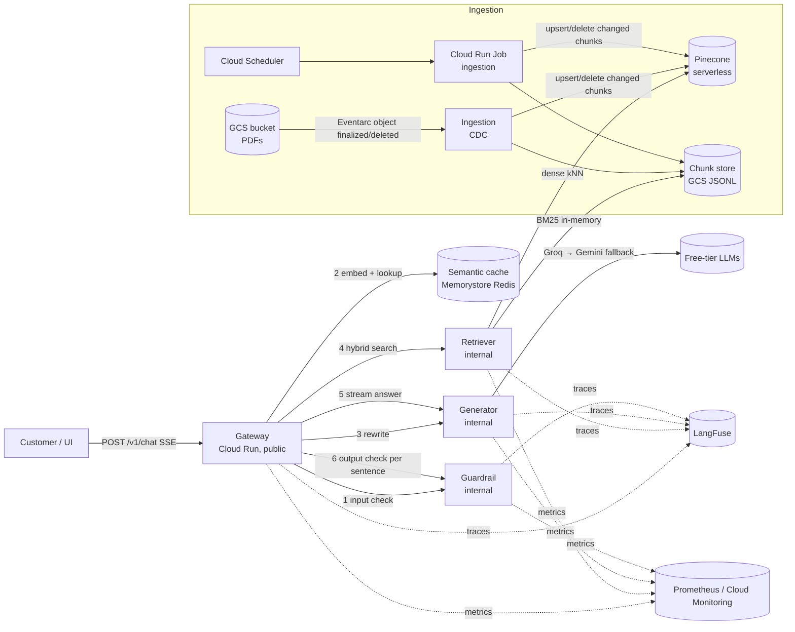

# LoanAssist — Production-grade RAG customer support for bank loans

A microservice RAG system that answers customer questions about **home loans, personal loans and car loans**
(interest rates, fees and charges, prepayment/foreclosure, eligibility, documents, RBI rules) from a knowledge
base of public bank PDFs. Built with **LangChain, Pinecone, FastAPI and Pydantic**, observable end-to-end with
**LangFuse**, evaluated with **RAGAS**, and deployed as separate **Cloud Run** services on Google Cloud.

Everything runs on free tiers: local BGE embeddings, Groq / Gemini free-tier LLMs (or Ollama locally), Pinecone
Starter, LangFuse Hobby.

| Capability | Where |
|---|---|
| Structure-aware chunking (paragraph / list / table chunks, table linearisation) | `services/ingestion/chunker.py` |
| PDF → Markdown with page markers | `services/ingestion/pdf_to_markdown.py` |
| Incremental ingestion with Change Data Capture (file + chunk level) | `services/ingestion/cdc.py`, `pipeline.py` |
| Hybrid search: BM25 + dense (Pinecone) + Reciprocal Rank Fusion | `services/retriever/` |
| Retrieved-chunk logging per query | `services/retriever/retrieval_logger.py` |
| Query rewriting + grounded generation, structured output via Pydantic, SSE streaming | `services/generator/` |
| Guardrails: PII redaction (in & out), prompt-injection defence, prompt-leak canary | `services/guardrail/` |
| Semantic cache, async orchestration, per-client throttling | `services/gateway/` |
| Exponential backoff, token-bucket throttling, circuit breakers, provider fallback | `common/resilience.py`, `services/generator/llm_client.py` |
| Observability (LangFuse distributed trace tree) | `common/observability.py` |
| Monitoring (cost, latency, TTFT, tokens, cache hit rate, breaker state) | `common/metrics.py`, `monitoring/` |
| RAGAS evaluation (faithfulness, answer relevancy, context precision, context recall) | `evaluation/run_ragas.py` |
| Cloud Run deployment (5 services + job + Eventarc CDC trigger) | `deploy/gcp/` |

---

## 1. Architecture



**Request lifecycle** (`services/gateway/orchestrator.py`):

1. **Input guardrail** – block prompt injection; replace PII with placeholders (`<PAN_1>`).
2. **Semantic cache** – embed the sanitized question (via the retriever's `/embed`), cosine kNN in Redis; ≥ 0.92 → answer in milliseconds, zero LLM tokens.
3. **Query rewrite** (small model, Pydantic `RewrittenQuery`) – standalone, keyword-rich query + product + intent; off-topic questions short-circuit.
4. **Hybrid retrieval** – Pinecone dense top-20 ∥ BM25 top-20 → RRF → top-5, filtered by product (plus `general` docs such as the RBI circular).
5. **Generation** – LangChain prompt with labelled passages `[S1]…[S5]`, streamed token-by-token over SSE (or Pydantic-validated `GeneratedAnswer` when `stream=false`).
6. **Output guardrail** – each sentence is checked before it is released to the customer (PII scrub, prompt-leak canary).
7. **Cache store** – only for PII-free questions with cited, answerable, non-low-confidence answers.

---

## 2. Project structure

```
bank-loan-rag-support/
├── common/                      # shared library, copied into every image
│   ├── config.py                # pydantic-settings: typed, validated configuration
│   ├── schemas.py               # ALL Pydantic contracts (requests, responses, LLM structured outputs)
│   ├── resilience.py            # retry w/ backoff+jitter, AsyncTokenBucket, CircuitBreaker
│   ├── http_client.py           # async inter-service client: ID-token auth, retries, breaker, SSE
│   ├── observability.py         # LangFuse tracer, cross-service trace propagation
│   ├── metrics.py / cost.py     # Prometheus metrics, token cost accounting
│   ├── app_factory.py           # FastAPI factory: JSON logs, trace id, latency metrics, throttling
│   ├── embeddings.py            # BGE-small (sentence-transformers) + hashing embedder for tests
│   ├── vectorstore.py           # Pinecone + in-memory adapters
│   ├── chunk_store.py, storage.py  # JSONL chunk corpus on local disk or GCS
│   ├── security.py              # prompt canary + system-prompt fingerprints
│   └── log.py                   # structured JSON logging (Cloud Logging compatible)
├── services/
│   ├── ingestion/               # PDF→MD, structure-aware chunker, CDC, pipeline, CLI + Eventarc endpoint
│   ├── retriever/               # FastAPI: /retrieve (hybrid + RRF), /embed, /admin/reload
│   ├── generator/               # FastAPI: /rewrite, /generate, /generate/stream (LangChain + Groq/Gemini/Ollama)
│   ├── guardrail/               # FastAPI: /check — PII redaction, injection detection, leak detection
│   └── gateway/                 # FastAPI: /v1/chat orchestration, semantic cache, demo UI
├── evaluation/                  # RAGAS runner + golden dataset (14 Q&A grounded in the PDFs)
├── monitoring/                  # Prometheus config + provisioned Grafana dashboard
├── deploy/gcp/                  # setup, Cloud Build, Cloud Run services/job, Eventarc, Scheduler
├── data/sources.yaml            # knowledge-base manifest (7 PDFs with tables)
├── scripts/                     # download_pdfs.py, monitoring_report.py
├── tests/                       # 36 unit/integration tests (no API keys needed)
├── docker-compose.yml, Makefile, pyproject.toml, requirements/*.txt, .env.example
└── .github/workflows/ci.yml
```

---

## 3. Knowledge base

Seven public PDFs, all containing tables (fee schedules, LTV grids, charge matrices, KFS formats). They are listed
in `data/sources.yaml` and downloaded by `python scripts/download_pdfs.py` (the files are not committed: they are
the banks' documents, and bank sites change URLs — update the manifest if a link moves).

| ID | Document | Product | Tables |
|---|---|---|---|
| `sbi_home_loan_mitc` | [SBI Home Loan – Most Important Terms & Conditions](https://homeloans.sbi/downloads/Terms-and-Conditions.pdf) | Home | LTV grid, processing-fee slabs |
| `muthoot_homefin_mitc` | [Muthoot Homefin Housing Loan MITC](https://www.muthoothomefin.com/public/uploads/MITC/MHIL-MITC.pdf) | Home | rate types, statutory & prepayment charges |
| `sbi_car_loan_mitc` | [SBI Auto/Car Loan MITC](https://sbi.co.in/webfiles/uploads/files/1336716430412_CAR_LOAN_MITC_MAY12.pdf) | Car | processing fee, prepayment |
| `idbi_personal_loan_soc` | [IDBI Bank Personal Loan Schedule of Charges](https://www.idbi.bank.in/pdf/soc/SOC-Personal-Loan.pdf) | Personal | charge grid |
| `bandhan_personal_loan_mitc` | [Bandhan Bank Personal Loan MITC (Jul 2026)](https://www.bandhan.bank.in/sites/default/files/2026-07/Personal-Loan-MITC-18072026.pdf) | Personal | schedule of charges |
| `bandhan_personal_loan_soc` | [Bandhan Bank Personal Loan Schedule of Charges (Jul 2026)](https://bandhan.bank.in/sites/default/files/2026-07/Personal-Loan-Schedule-of-Charges-July-2026.pdf) | Personal | description/charge table |
| `rbi_kfs_circular_2024` | [RBI – Key Facts Statement for Loans & Advances (15 Apr 2024)](https://website.rbi.org.in/documents/87730/39710850/Circular+KFS_180424_Final_For_Website.pdf) | General | Annex A/B/C: KFS, APR, repayment schedule |

Multiple lenders per product is deliberate: the assistant must say *which* lender a figure comes from, and
retrieval has to separate near-identical passages from different documents.

---

## 4. Chunking strategy (structure-aware)

`services/ingestion/chunker.py` — the goal is **one self-contained semantic unit per chunk**.

**Step 1 – PDF → Markdown.** `pymupdf4llm` converts each page and renders detected tables as GitHub pipe tables.
We insert `<!-- page: N -->` markers (page numbers for citations), strip running headers/footers that repeat on
>50 % of pages, re-join hyphenated words and turn `<br>` inside cells into spaces. The Markdown is saved to
`data/markdown/<doc_id>.md` so you can inspect what the chunker sees. (`PDF_CONVERTER=docling` switches to the
MIT-licensed Docling converter.)

**Step 2 – parse into typed blocks**, tracking the heading hierarchy and current page:
`heading | paragraph | list | table`. Bank MITCs often render section titles as bold lines
(`**Loan Tenor:**`), so short fully-bold lines are treated as level-7 pseudo-headings.

**Step 3 – assemble chunks:**

| Block | Rule |
|---|---|
| Paragraph | Its own chunk. Fragments below `CHUNK_MIN_TOKENS` merge with the next paragraph in the same section (or back into the previous one) so no chunk is meaningless on its own. Paragraphs above `CHUNK_MAX_TOKENS` split on sentence boundaries — never mid-sentence. |
| List | Its own chunk **together with its lead-in sentence** ("The loan will be disbursed only on the following conditions:"). Long lists split by item, repeating the lead-in. |
| Table | Its own chunk, never mixed with prose (details below). |

Every chunk is prefixed with a **contextual header** — `[SBI Home Loan MITC] Fees > Processing fee` — so a
fragment like "0.35% of the loan amount" still carries *which bank* and *which fee* when it is embedded and
BM25-indexed.

### How tables are handled

1. **Stitching across pages** – a table that continues after a page break (same column count, header repeated or
   not) is merged back into one table; a repeated header row is dropped.
2. **Cleaning** – empty columns/rows are removed; the header is taken from the row above the `|---|` separator.
   pymupdf4llm sometimes emits placeholder headers (`Col2`) and glues a stray text line above the table into the
   header row; when the header is mostly placeholders and the first row is fully populated, that row is promoted
   to header.
3. **Caption** – a short paragraph just before the table (or one ending in `:`) becomes the table caption instead
   of a separate tiny chunk.
4. **Two representations per table chunk:**
   * `display_text` (what the **LLM** reads): the clean **Markdown table** — LLMs reason well over pipe tables and
     can compare rows.
   * `text` (what is **embedded and BM25-indexed**): a **row-linearised** form that pairs each cell with its column
     header, e.g. `Period from disbursement: Within 12 months | Charge: 5% of the amount paid`. A bare grid of
     numbers embeds poorly; header-value pairs make "prepayment charge in the first year" land on the right row,
     and give BM25 the exact tokens (`5%`, `12 months`).
5. **Large tables** – tables over `TABLE_MAX_ROWS_PER_CHUNK` (15) rows are split into row groups; **every part
   repeats the header row and caption** and carries `table_meta` (`table_id`, `part`, `total_parts`, `columns`),
   so each part is interpretable on its own and siblings can be re-assembled if needed.

**Chunk IDs are content-addressed**: `doc_id::sha256(content)[:16]`. The same passage always gets the same ID —
that is what makes the CDC diff below cheap.

---

## 5. Incremental ingestion with Change Data Capture

`services/ingestion/cdc.py`, `pipeline.py`

| Level | How | Effect |
|---|---|---|
| **File** | SHA-256 of each PDF vs. the last committed state (`cdc_state.json` on GCS) | New → INSERT, different hash → UPDATE, missing → DELETE, same → **skipped entirely** (no conversion, no embedding) |
| **Chunk** | For INSERT/UPDATE files: new chunk-ID set vs. old set | Only new/edited chunks are embedded and upserted; vanished chunks are deleted from Pinecone; moved-but-identical chunks get a metadata-only update |

Editing one row of a 30-row fee table re-embeds **one** chunk, not the document (asserted in `tests/test_cdc.py`).

**Commit protocol**: vector store first → chunk store → `chunks.jsonl.version` marker → CDC state ("log
position") last. A crash mid-run re-processes the same changes next time, and Pinecone upserts/deletes are
idempotent, so the pipeline is safe to re-run. Every run appends its change events to `cdc_events.jsonl` (audit
trail).

**Triggers on GCP** (`deploy/gcp/03_ingestion_cdc.sh`):
* **Event-driven** – Eventarc on `google.cloud.storage.object.v1.finalized|deleted` for the bucket →
  `rag-ingestion-events` (`POST /events/gcs`), which acks immediately and runs CDC in the background. Max one
  instance with concurrency 1, so runs never overlap.
* **Batch safety net** – Cloud Run **Job** `rag-ingestion`, run nightly by Cloud Scheduler (and on demand).

**Propagation to retrievers**: ingestion writes `chunks.jsonl.version`; every retriever instance polls it every
60 s and hot-swaps its BM25 index atomically, so all replicas pick up changes (not just the one that received
`/admin/reload`).

---

## 6. Hybrid search and Reciprocal Rank Fusion

`services/retriever/`

* **Dense** – query embedded with `BAAI/bge-small-en-v1.5` (+ BGE query instruction), cosine kNN in Pinecone
  serverless (top-20, metadata filter on product).
* **Sparse / keyword** – **BM25 Okapi** (`k1=1.5, b=0.75`) over the same chunks, in memory. The tokenizer keeps
  banking tokens that embeddings blur: `0.35%`, `30,00,000` → `3000000`, `Rs.`/`₹` → `inr`, `EBLR`, `NACH`,
  `CERSAI`, `KFS`.
* Both run **concurrently** (`asyncio.gather`; CPU-bound work in threads).
* **Reciprocal Rank Fusion** (`hybrid.py`):

  `RRF(d) = Σ_r  w_r / (k + rank_r(d))`, `k = 60`

  RRF uses ranks only, so cosine similarities (0–1) and BM25 scores (unbounded) never need normalising against
  each other; a chunk ranked well by *both* beats one ranked first by only one. Ties break on number of agreeing
  rankers, then best single rank. Optional per-ranker weights.
* Every returned chunk carries `dense_score/rank`, `bm25_score/rank`, `rrf_score`, `final_rank`.
* **Graceful degradation** – Pinecone calls sit behind retries + a circuit breaker; if it is down, retrieval
  falls back to BM25-only instead of failing the request.

**Retrieved-chunk logging** – each query writes one JSON record (trace id, query, product filter, per-chunk
ids/scores/ranks, latency) to stdout → Cloud Logging (`jsonPayload.event="retrieval"`, sink to BigQuery for
analysis) and to `data/logs/retrievals.jsonl` locally.

---

## 7. Generator, Pydantic and streaming

* **Pydantic everywhere** (`common/schemas.py`): every request/response is a `StrictModel` (`extra="forbid"`,
  constrained strings, enums, bounds) — malformed input is a 422 at the edge, not a bug downstream. Config is
  validated by `pydantic-settings`.
* **Structured LLM output**: `llm.with_structured_output(Model, include_raw=True)` for
  `RewrittenQuery` (rewritten query, `LoanProduct`, intent, `is_banking_question`) and `GeneratedAnswer`
  (answer, `cited_sources` matching `^S\d{1,2}$`, confidence, answerable flag, human-handoff flag). If a model
  ignores the tool schema, the raw text is validated with `model_validate_json` once; a validation error is
  treated as a retryable failure and can trigger the fallback provider.
* **Citations**: passages are labelled `[S1]…[S5]` (far more reliable for small models than 30-char IDs) and
  mapped back to `chunk_id`, file and page.
* **Streaming**: `/generate/stream` emits SSE `token` → `citations` → `done` (model, usage, cost, latency). The
  gateway relays tokens sentence-by-sentence through the output guardrail.
* **Free LLMs**: Groq `llama-3.3-70b-versatile` (answers) and `llama-3.1-8b-instant` (rewrite) → fallback to Gemini
  Flash (Google AI Studio free tier) → or fully local Ollama.

---

## 8. Guardrail service

`services/guardrail/` — a separate service so policy can change and scale independently of the LLM path.

**PII redaction (input *and* output)** — regexes tuned for Indian banking, with validation to avoid false
positives on amounts, rates and tenures:

| Entity | Validation |
|---|---|
| Aadhaar | 12 digits starting 2–9 **+ Verhoeff checksum** |
| Card number | 13–19 digits **+ Luhn checksum** |
| PAN | `AAAAA9999A` with a valid holder-type 4th letter |
| Bank account | 9–18 digits **only in context** ("account no", "a/c") |
| Mobile, e-mail, IFSC, UPI ID, passport, IPv4 | pattern + context |
| Person / location names | optional Microsoft Presidio (spaCy NER), `USE_PRESIDIO=true` |

Overlaps resolve by priority then length. Each distinct value gets a stable placeholder (`<PAN_1>` twice for the
same PAN), so the model can still say "the PAN you shared" without seeing it. Raw PII never reaches the LLM, the
cache, the logs or LangFuse (the guardrail traces only sanitized text and entity types). Streaming output is
checked **per sentence before release**, so an identifier cannot leak mid-stream.

**Prompt-injection defence (layered)**
1. *Normalisation* – NFKC, strip zero-width/bidi characters, leetspeak variant, decode base64 payloads.
2. *Weighted heuristics* – instruction override, system-prompt exfiltration, persona jailbreaks (DAN, developer
   mode), fake role/delimiter tokens (`<|im_start|>`, `</context>`, `### system`), fake authority, bulk requests for
   other customers' data, code/SQL execution; combined with noisy-OR, block at ≥ 0.7.
3. *Optional ML classifier* – `protectai/deberta-v3-base-prompt-injection-v2` (free, Apache-2.0),
   `USE_INJECTION_CLASSIFIER=true`.
4. *Prompt hardening* – the system prompt declares passages and questions as **data**, wraps context in
   `<context>` tags and forbids following embedded instructions (defends against *indirect* injection hidden in a
   PDF).
5. *Leak detection* – a secret **canary token** in the system prompt plus fingerprints of its distinctive sentences;
   if the output contains either, the output guardrail blocks it.

Benign phrasing such as "Ignore the processing fee for now, what's the car-loan rate?" is not blocked (tested).

---

## 9. Security features

* **Network isolation** – only the gateway is public. Retriever, generator and guardrail use
  `--ingress=internal` **and** `--no-allow-unauthenticated`; the gateway reaches them over Direct VPC egress with a
  **Google-signed ID token** (audience = callee URL, cached ~55 min). Only the gateway's service account has
  `roles/run.invoker` on them.
* **Least privilege** – one service account per service; retriever has read-only bucket access, ingestion
  read/write; each service can read only the secrets it needs.
* **Secrets** in Secret Manager, injected as env vars; nothing sensitive in images or git (`.env` ignored).
* **Input validation** – Pydantic strict models with length limits on every endpoint; `session_id` regex.
* **Abuse protection** – per-client token-bucket rate limit at the gateway (429 + `Retry-After`), LLM quota
  throttles, bounded history (10 turns), bounded output tokens.
* **Data protection** – PII redacted before the LLM, never cached (questions containing PII skip the cache),
  never traced; containers run as non-root (`uid 10001`).
* **LLM-specific** – injection detection, context-as-data prompting, canary-based leak detection, no tools/actions
  exposed to the model.
* For production add Cloud Armor (WAF / bot management) and API keys or Identity Platform in front of the gateway.

---

## 10. Production behaviour: caching, streaming, async, resilience

**Semantic cache** (`services/gateway/semantic_cache.py`) – Redis vector index (FLAT, cosine) shared by all gateway
instances (Memorystore for Redis 7.2 on GCP, Redis Stack locally); in-memory LRU+TTL fallback. Threshold 0.92,
TTL 24 h. Keyed on the sanitized question (or the rewritten standalone question for follow-ups). Hit rate is a
Prometheus metric.

**Async, non-blocking workers** – every handler is `async`; all I/O uses `httpx.AsyncClient` with pooled
connections; CPU-bound work (embedding, BM25 scoring, Pinecone's sync SDK, Presidio/classifier) runs in
`asyncio.to_thread`, so one uvicorn worker multiplexes many concurrent streams. Scale with `WEB_CONCURRENCY` and
Cloud Run instances/concurrency.

**Resilience** (`common/resilience.py`):
| Mechanism | Detail |
|---|---|
| Exponential backoff + full jitter | `sleep ~ U(0, min(max, base·2ⁿ))`; honours `Retry-After` on 429; retries only on 408/409/425/429/5xx, timeouts and transport errors — never on other 4xx |
| Throttling | two token buckets per LLM provider: **requests/min** and **tokens/min** sized under the free-tier quota, so requests queue locally instead of collecting 429s; per-IP bucket at the gateway |
| Circuit breaker | per upstream (each LLM provider, Pinecone, each internal service): CLOSED → OPEN after 5 consecutive failures → HALF_OPEN probe after 30 s; fails fast while open; state exported as a metric |
| Fallback | LLM: Groq → Gemini (→ Ollama); retrieval: dense+BM25 → BM25-only |
| Streaming safety | retries/fallback happen only before the first token; after that a failure becomes an SSE `error` event |

Retries wrap the breaker, so each attempt counts toward tripping it and an open breaker stops the remaining
attempts. SDK-level retries are disabled (`max_retries=0`) so there is exactly one retry policy. Note: the token
buckets are per instance — set `LLM_REQUESTS_PER_MINUTE` to roughly quota ÷ max instances.

---

## 11. Observability — LangFuse (and why not LangSmith)

Every query produces **one trace tree across four services**. The gateway mints a 32-hex trace id and opens
`chat_request`; every internal call carries `X-Trace-Id` and `X-Parent-Span-Id`, and each service attaches its
span with `trace_context={trace_id, parent_span_id}`:

```
chat_request (gateway)          metadata: raw query (sanitized), rewritten query, retrieved chunk IDs + scores,
 │                                         cache hit, latency, session id
 ├─ guardrail.input             sanitized text, PII types, injection score/reasons
 ├─ semantic_cache.lookup       hit/miss, similarity, matched question
 ├─ generator.rewrite           GENERATION: prompt, RewrittenQuery output, tokens, cost
 ├─ retriever.hybrid_search     per chunk: id, rank, rrf score, dense score/rank, bm25 score/rank, source, page
 ├─ generator.generate_stream   GENERATION: full prompt composition (every message, label→chunk map with
 │                              scores, history size), answer, tokens, cost, citations
 └─ guardrail.output            redactions / leak blocks
```
RAGAS scores are attached to the same traces (`ragas_faithfulness`, …) by `evaluation/run_ragas.py`.

**Why LangFuse**
* **Open source (MIT) and self-hostable** for free — for a bank, traces contain customer questions, and keeping them
  in your own GCP project matters (DPDP Act 2023, RBI outsourcing and data-localisation expectations). LangSmith's
  self-hosted deployment is part of its paid enterprise offering.
* **Framework-agnostic, OpenTelemetry-based** – our services are plain FastAPI with LangChain used only inside the
  generator; LangFuse's `trace_context` propagation stitches spans from four processes into one tree. LangSmith is
  at its best inside a single LangChain/LangGraph runtime.
* **Free Hobby cloud tier** to start, no credit card; model-agnostic **cost tracking** with our own price table;
  **scores API** for RAGAS results, plus prompt management and datasets.
* LangSmith remains an excellent choice if you are all-in on LangChain/LangGraph and want its evaluation UI; the
  tracer is isolated in `common/observability.py`, so swapping is a one-file change.

If LangFuse keys are unset, tracing becomes a no-op (tests and local dev run without it). Observations are created
with explicit `start_span`/`start_generation` + `.end()` because spans stay open across `yield`s of streaming
responses.

---

## 12. Model monitoring (cost, latency, quality)

Every service exposes Prometheus metrics at `/metrics` (`common/metrics.py`):

| Metric | Labels | Use |
|---|---|---|
| `http_request_duration_seconds` | service, route, status | p50/p95 latency per service |
| `llm_request_duration_seconds`, `llm_time_to_first_token_seconds` | model, operation | LLM latency, streaming TTFT |
| `llm_tokens_total` | model, kind | token volume vs. free-tier quota |
| `llm_cost_usd_total`, `llm_shadow_cost_usd_total` | model | actual cost ($0 on free tier) and **what the same traffic would cost on a paid tier** |
| `llm_errors_total`, `llm_fallback_total` | model, error | provider health |
| `retrieval_duration_seconds` | stage (embed/dense/bm25/rrf/total) | retrieval bottlenecks |
| `retrieval_top_rrf_score` | – | drift signal: falling top scores = questions the KB doesn't cover |
| `semantic_cache_events_total` | hit/miss/store | cache hit rate |
| `circuit_breaker_state`, `retries_total`, `throttled_requests_total` | – | resilience |
| `guardrail_events_total` | direction, action | blocked injections, redactions |

Locally `docker compose up` starts Prometheus (`:9090`) and Grafana (`:3000`) with a provisioned dashboard
(`monitoring/grafana/dashboards/bank_rag.json`). `python scripts/monitoring_report.py` prints a text summary. On
GCP use Google Cloud Managed Service for Prometheus, or log-based metrics on the structured JSON logs; LangFuse
also shows cost and latency per trace and per model.

---

## 13. Evaluation with RAGAS

`evaluation/run_ragas.py` runs the production path (rewrite → hybrid retrieve → generate, cache bypassed) for
every question in `evaluation/golden_dataset.jsonl` (14 questions with reference answers taken from the source
PDFs) and scores:

| Metric | Question it answers |
|---|---|
| **faithfulness** | Are the answer's claims supported by the retrieved context? (hallucination) |
| **answer_relevancy** | Does the answer address the question? |
| **context_precision** (LLM, with reference) | Are relevant chunks ranked above irrelevant ones? (ranking quality of RRF) |
| **context_recall** | Does the retrieved context contain everything the reference answer needs? |

The judge is the free Groq model, embeddings are the local BGE model; `RunConfig(max_workers=2, max_retries=8)`
keeps it inside free-tier limits. Output: per-sample CSV + summary JSON in `evaluation/results/`, scores pushed to
LangFuse. Thresholds turn it into a CI gate:

```bash
pip install -r requirements/eval.txt
python -m evaluation.run_ragas --min-faithfulness 0.8 --min-context-recall 0.7
```
Re-check the reference answers whenever you update a PDF (the documents' figures change over time).

---

## 14. Run locally

Prerequisites: Python 3.11+, Docker, free API keys for **Pinecone** and **Groq** (optional: Google AI Studio,
LangFuse).

```bash
git clone <your-repo> && cd bank-loan-rag-support
cp .env.example .env                    # fill PINECONE_API_KEY, GROQ_API_KEY (+ optional keys)
python scripts/download_pdfs.py         # -> data/pdfs/*.pdf
docker compose --profile jobs run --rm ingestion    # CDC load into Pinecone (re-run: only changes)
docker compose up -d --build            # gateway :8000, retriever :8001, generator :8002, guardrail :8003
open http://localhost:8000              # demo chat UI
```

API:
```bash
# streaming (SSE)
curl -N -X POST localhost:8000/v1/chat -H 'Content-Type: application/json' \
  -d '{"query":"What are the foreclosure charges on a Bandhan personal loan?","stream":true}'
# JSON
curl -X POST localhost:8000/v1/chat -H 'Content-Type: application/json' \
  -d '{"query":"Is there a prepayment penalty on SBI floating rate home loans?","stream":false}'
```
OpenAPI docs: `/docs` on each service.

Without Docker: `pip install -r requirements/<service>.txt` and run
`uvicorn services.<service>.app:app --port 800X` for each, `python -m services.ingestion.main` for ingestion.

Tests (no keys or network needed — in-memory vector store, hashing embedder, fake LLMs):
```bash
pip install -r requirements/dev.txt && pytest       # 36 tests
```

---

## 15. Deploy to Google Cloud Run

Each component is its own Cloud Run service (plus a Cloud Run job), built by Cloud Build and stored in Artifact
Registry.

| Cloud Run resource | Ingress / auth | Sizing (start) |
|---|---|---|
| `rag-gateway` | public | 1 vCPU / 512 MiB, concurrency 100, min 1 |
| `rag-retriever` | internal, IAM | 2 vCPU / 2 GiB (embedding model in RAM), min 1 |
| `rag-generator` | internal, IAM | 1 vCPU / 512 MiB, timeout 300 s (streams) |
| `rag-guardrail` | internal, IAM | 1 vCPU / 512 MiB |
| `rag-ingestion-events` (service) + `rag-ingestion` (job) | internal, IAM | 2 vCPU / 4 GiB, max 1 instance |

**Steps**
1. **Install & log in**: `gcloud auth login && gcloud auth application-default login`.
2. **Configure**: edit `deploy/gcp/env.sh` (`PROJECT_ID`, `REGION` — default `asia-south1` Mumbai, bucket, VPC).
3. **One-time setup**: `bash deploy/gcp/01_setup.sh` — enables APIs (Run, Artifact Registry, Cloud Build, Secret
   Manager, Eventarc, Memorystore, Scheduler…), creates the Docker repo, the GCS bucket, one service account per
   service with least-privilege IAM, Secret Manager secrets from your `.env`, and a Memorystore for Redis 7.2
   instance for the semantic cache.
4. **Build & deploy services**: `bash deploy/gcp/02_build_and_deploy.sh` — Cloud Build runs the tests then builds the
   five images in parallel (`deploy/gcp/cloudbuild.yaml`); deploys retriever/generator/guardrail as internal +
   authenticated, grants the gateway SA `run.invoker`, then deploys the public gateway wired to their URLs with
   `USE_GCP_ID_TOKEN=true`, Direct VPC egress and the Redis host.
5. **Load the knowledge base + CDC**: `bash deploy/gcp/03_ingestion_cdc.sh` — uploads PDFs to
   `gs://$BUCKET/pdfs/`, creates and executes the ingestion **job**, schedules it nightly, deploys
   `rag-ingestion-events` and creates **Eventarc** triggers for object finalized/deleted. From now on, dropping a
   new or edited PDF into the bucket updates Pinecone within seconds, touching only changed chunks.
6. **Smoke test**: `curl -N -X POST $(gcloud run services describe rag-gateway --region $REGION --format 'value(status.url)')/v1/chat -H 'Content-Type: application/json' -d '{"query":"processing fee for SBI car loan?"}'`
7. **Observe**: LangFuse for traces; Cloud Logging (`jsonPayload.event="retrieval"`) for retrieval logs;
   Managed Prometheus or log-based metrics for dashboards and alerts (e.g. breaker open, p95 > 8 s, cache hit rate
   drop).
8. **CI/CD**: `.github/workflows/ci.yml` lints, tests and builds images on every push; connect a Cloud Build
   trigger to the repo (or add a deploy job with Workload Identity Federation) for continuous deployment.

Free-tier notes: Cloud Run's monthly free allowance covers a demo with `min-instances=0`; `min-instances=1` on the
gateway/retriever avoids cold starts but is billed, and Memorystore is a paid service — for a zero-cost demo set
`CACHE_BACKEND=memory` and drop the Redis step.

---

## 16. Configuration reference

All settings live in `common/config.py` (validated by Pydantic) and can be set via env vars (`.env.example`).
Key knobs: `CHUNK_MIN_TOKENS`/`CHUNK_MAX_TOKENS`/`TABLE_MAX_ROWS_PER_CHUNK`, `DENSE_TOP_K`/`BM25_TOP_K`/
`FINAL_TOP_K`/`RRF_K`, `LLM_PROVIDER`/`LLM_FALLBACK_PROVIDER`, `LLM_REQUESTS_PER_MINUTE`/`LLM_TOKENS_PER_MINUTE`,
`RETRY_MAX_ATTEMPTS`, `BREAKER_FAILURE_THRESHOLD`/`BREAKER_RESET_TIMEOUT_S`, `CACHE_BACKEND`/
`CACHE_SIMILARITY_THRESHOLD`, `USE_PRESIDIO`, `USE_INJECTION_CLASSIFIER`, `BILL_SHADOW_COST`.

## 17. Design notes and limitations

* PDF table extraction quality depends on the source PDF; scanned PDFs need OCR (Docling supports it). Inspect
  `data/markdown/*.md` after ingestion and tune.
* BM25 lives in each retriever's memory — ideal for thousands of chunks. For millions, move sparse search to
  Pinecone sparse vectors or Elasticsearch/OpenSearch and keep RRF unchanged.
* Free-tier LLM quotas are the real throughput limit; the throttles keep you inside them but cannot raise them.
* Answers are informational, not financial advice; the prompt routes personal decisions to a loan officer.

## License
MIT — see `LICENSE`. The knowledge-base PDFs belong to their publishers and are downloaded at runtime, not
redistributed.
